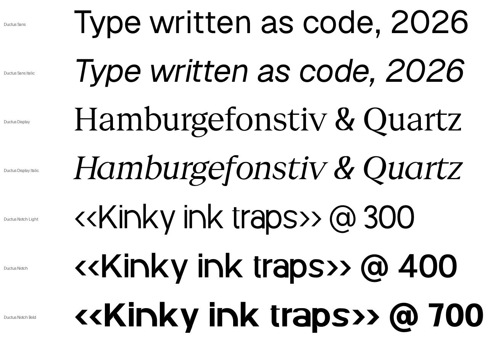

# Ductus

**A parametric font design language and compiler.** In Ductus you write a
typeface as Python. Each glyph is built from named strokes drawn with a
broad-nib pen, contour parts (bowls, lobes, joins) and parameters shared
across the whole font. The compiler expands the strokes, removes overlaps
and writes an OpenType (CFF) `.otf`. Static fonts, variable fonts and
italics all come from the same source.



```python
@glyph("n")
def n(g):
    g += stem_(x=0, top=xheight)          # a named stroke
    g += arch(x=0, width=n_width)         # a shared part: h and m reuse it

@glyph("h")
def h(g):
    g.inherit("n")
    g["stem"].top = ascender              # change one argument of an inherited part
```

Change `stem`, `contrast` or `xheight` and every glyph follows. Hand
adjustments live apart from the code, as small named deltas in
`overrides.yaml` (`n.arch.shoulder: {dx: 12}`). A parameter change therefore
never breaks them, and they can never break interpolation.

## The faces

| Face | What it is | Glyphs | Builds |
|---|---|---|---|
| **Ductus Sans** | A grotesque, tuned toward Geist Sans by measurement. | 183 | `wght` 300–700 × `opsz` 8–14 variable font, italic |
| **Ductus Display** | A high-contrast display serif, refined by eye. | 184 | `opsz` 9–72 variable font, italic with a true single-storey a and cursive f |
| **Ductus Notch** | An ink-trap neo-grotesque designed from scratch, never fitted to a reference. | 187 | `wght` 300–700 variable font |

All three come from one *kit* (`ductus/ductus/kits/serif.py`), in which every
construction is written once against a parameter namespace. A new face is a
set of parameter values, a terminal set (serifs or none) and a few style
switches. Each face has a design log with an image for every iteration:
[Sans](ductus/docs/sans/README.md), [Display](ductus/docs/display_serif/README.md)
and [Notch](ductus/docs/notch/README.md).

## Quick start

You need Python 3.11 or later.

```bash
git clone https://github.com/mszarski/ductus.git
cd ductus/ductus
python -m venv .venv && source .venv/bin/activate
pip install -e ".[proof,validate,serve,test]"
```

```bash
ductus build examples/notch/font.py -o out/              # static .otf
ductus build examples/notch/font.py --variable -o out/   # variable font
ductus serve examples/notch/font.py                      # live editor at http://127.0.0.1:8765/
pytest                                                   # the test suite
```

The [getting started guide](ductus/docs/guide/getting-started.md) goes
further: building every face, proofs, and writing a first glyph.

## Documentation

- **[Guide](ductus/docs/guide/README.md)**, starting points:
  - [Getting started](ductus/docs/guide/getting-started.md)
  - [The language](ductus/docs/guide/language.md): parameters, pens, strokes,
    parts, terminals, overrides
  - [Building fonts](ductus/docs/guide/building.md): variable fonts, optical
    sizes, italics, spacing and kerning, ink traps
  - [Tools](ductus/docs/guide/tools.md): the command line, the live editor,
    the browser editor, the benchmark
- [Reference manual](ductus/README.md): the long-form notes on the compiler,
  its primitives and its design decisions.
- [Fitting workflow](ductus/docs/fitting.md): how a face is refined glyph by
  glyph against a reference, and the rules that keep that safe.
- [HANDOFF.md](HANDOFF.md): current state, latest numbers and open
  questions.

## Repository layout

```
ductus/                 the Python project (run commands from here)
  ductus/               the compiler: skeletons, pens, profiles, junctions, contours,
                        terminals, compile, emit, lint, kerning, variable, italic,
                        traps, tidy, the live editor (serve/)
  ductus/kits/serif.py  the kit every face is built from
  examples/             sans/, display_serif/, notch/, test_font/
  benchmarks/           internal benchmarks fitted to reference fonts (never released)
  web/                  the editor that runs entirely in the browser (Pyodide + Paper.js)
  docs/                 the guide, the design logs and their iteration sheets
  tests/                pytest suite
  tools/fitting/        fitting helpers
```

## Status and licensing

Ductus is a research project. The language grows by trying to represent
real, high-quality type and measuring the gap.

- **Reference fonts.** Geist Sans and Geist Serif (SIL OFL) are downloaded
  into git-ignored folders and used only for measurement and overlays.
  Their outlines are never copied, traced or imported.
- **Release status.** Fonts fitted to a reference stay in `benchmarks/` and
  are never released. Whether Ductus Sans may be released is an open
  question. Ductus Display and Ductus Notch are drawn by eye.
- **License.** The repository does not yet declare one.
