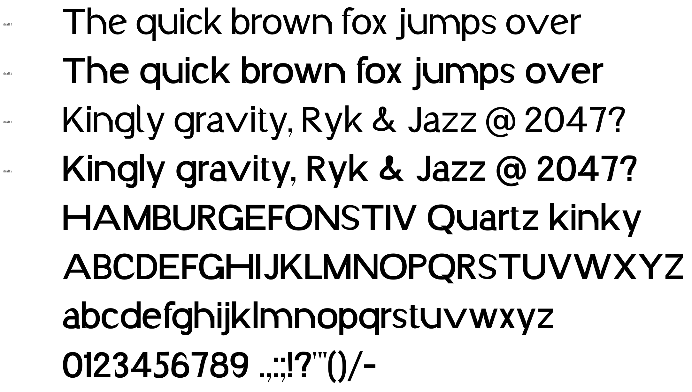
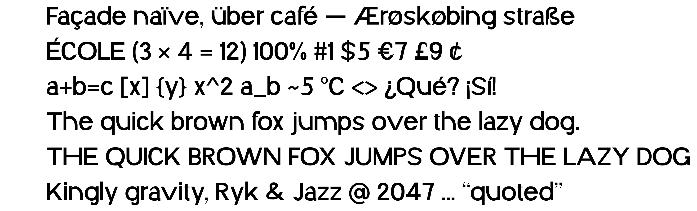
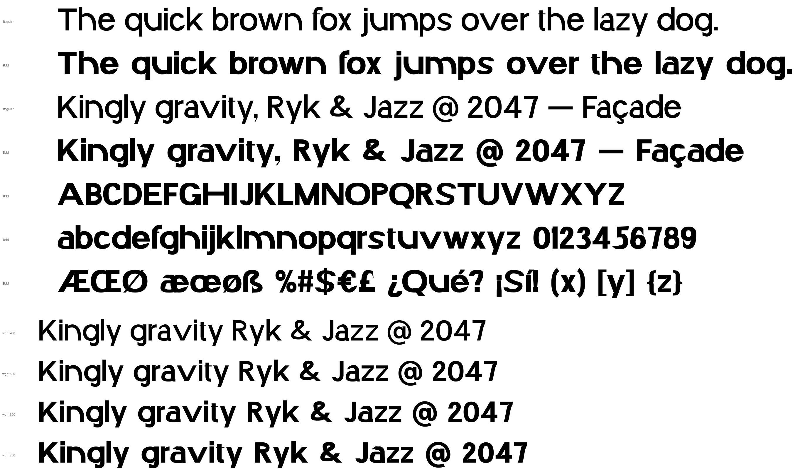
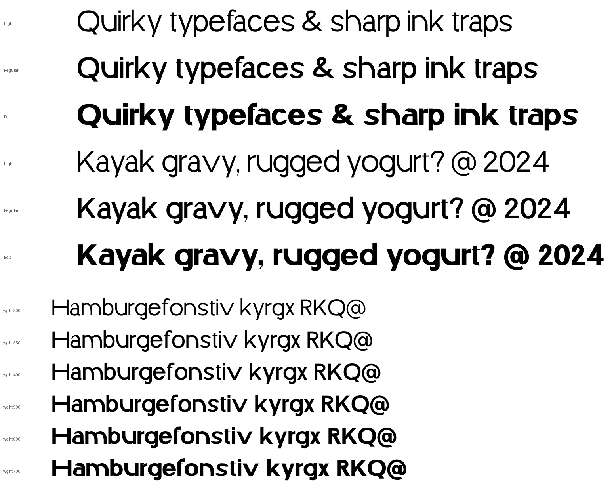
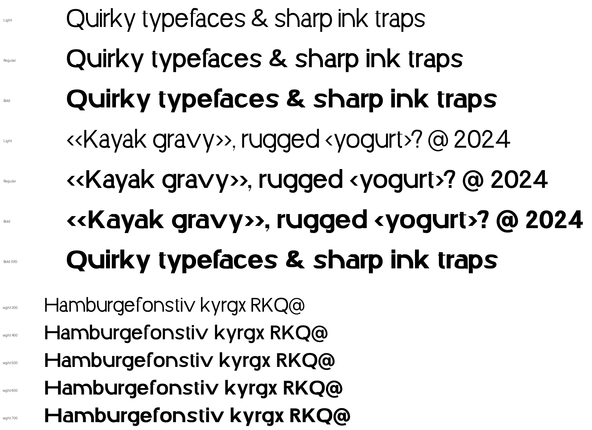
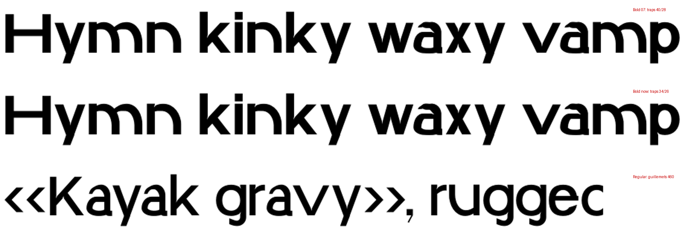
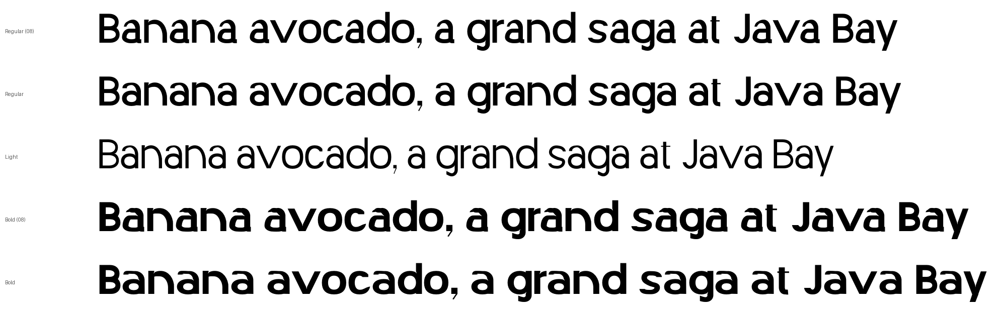

# Ductus Notch — design log

An ink-trap grotesque, designed by eye. No reference was fitted: it starts
from the kit's neutral defaults with the grotesque terminal set. So, unlike
Ductus Sans, it carries no licensing question.

## 01 — first draft: traps by rule, the signatures

**Ink traps are a rule, not a construction** (`ductus/traps.py`,
`font.traps`). After a glyph is merged, every sharp concave corner of its
outline, where the white wedges into the ink at less than `trap_angle`
(80°), gets a triangular notch:
- its mouth sits on the two edges, `trap_mouth` (26) from the corner;
- its tip goes `trap_depth` (44) into the ink along the bisector.

So the n's and m's crotches, the d, b, p and q lobe joins, the insides of
v, w, A, M, N and V, and the forks of k and K are trapped without touching
any construction. `"skip"` leaves the commas and quotes alone, since their
dot-to-tail joint is no crotch. The stems lint measures the outline before
the traps (`CompiledGlyph.untrapped`).

**Weight.** A monoline face from three numbers in `font.py` (stem 92,
thin 78, capital stem 98): every thin and thick part is derived from them.
Other settings:
- x-height 548;
- arches with little contrast;
- curved stroke ends cut on a slant (the `sans_cut_*` angles).

**Signatures** (new `kit.define` options and controls, all defaulting to
the old outlines; the other faces are unchanged glyph for glyph):
- **Flat-footed descenders:** `g_tail="foot"` and `y_tail="foot"`
  (`y_foot_r`). g, j and y turn a tight corner into a level flag to the
  left.
- **Branched k and K:** the leg springs from the arm, away from the stem.
  That gives a Y with two trapped crotches (values only: `k_leg_x0` and
  `k_leg_y0` on the arm).
- **R:** its leg springs from the stem under the bowl, not from the bowl.
- **The angled bar:** `e_bar_tilt` (12°; the e's aperture follows the
  bar). The a's straight top rises to match (`a_bt_tilt`).
- **t:** its top cut at 50° (the face's own `t_top` terminal,
  `sans_cut_ttop`).
- **& ? @:**
  - a one-stroke looped & (`amp_style="stroke"`);
  - a ? at full weight to its end;
  - an upright @ whose inner stem runs on into the ring
    (`at_style="hook"`).

**Spacing and kerning.** Side bearings are set by eye (f, r, L, t, T, j,
J). Kerning is optical, from these outlines, with no house style:
`ductus kern examples/notch/font.py`.

Self-critique, for the next round:
- the capitals are spaced tight, and the A's trapped crossbar is busy;
- the a's tilted top reads oddly at small size;
- the G's jaw trap looks like an arrow;
- C, S, c and s ends are a little sharp;
- the figures are plain;
- it covers 66 glyphs: no accents yet, no Bold.

## 02 — more modern: a second attempt

The user found draft 1 weird. It had too many quirks at once:
- tilted e and a bars, flat-footed descenders, the R's leg from the stem;
- a light weight with airy spacing, and slanted stroke ends;
- traps that read as thin slits.

Draft 2 moves toward a contemporary neo-grotesque:
- **Weight:** medium (stem 112, thin 98, capitals 118), with a big x-height
  (560) and compact widths.
- **Shape:** slightly squarer bowls (fullness 0.66), level stroke ends
  (the kit's grotesque cuts), and the f's hook cut square.
- **Traps:** shallow and clean (30 deep, mouth 24): functional at small
  sizes, a quiet detail large. The G is skipped, because its jaw meets the
  bowl at an acute angle that a trap turned into an arrowhead. Its bar also
  sits a little higher (`G_bar_y` 0.5) and its jaw 8 units out
  (`G_jaw_dx`), so at this weight the jaw stands clear of the bowl's wall
  and the bar.
- **Signatures, fewer and quieter:**
  - the branched k and K;
  - a straight-tailed y (new `y_tail="straight"`: the tail runs on to the
    descender and stops on a level cut);
  - the hooked @ and the looped &;
  - a plain single-storey g and a hooked j.
- **Dropped:** the tilted bars, the flat feet, the stem-sprung R and the
  slanted t top. Their kit options remain for other faces.

Self-critique:
- the C's lower terminal tapers;
- the t's curled tail is a little old-fashioned beside the rest;
- the 1's arm is thin;
- still 66 glyphs, Regular only.

## 03 — rough edges from overlapping strokes

The user found draft 2 interesting but rough where strokes overlap. A scan
of the outlines before traps (corners with a neighbouring segment under
14 units, needle spikes) plus 4× zooms of every hit found three kinds of
fault.

**Leftovers a few units long**, where one stroke ends inside another just
off its edge: steps in U, z, Z, 2, 6, 7 and 9, the e's bar end, the t's
tail and the Q's tail, and spikes in m, u and M. A new rule fixes them
wherever they occur (`ductus/tidy.py`, `font.tidy = {"step": 16, "spike":
150}`, run after merge and before the traps):
- two corners joined by a segment (straight or curved) shorter than `step`
  collapse into one point;
- a needle spike between two straight edges is removed.

Anything longer is left as design.

**Traps where there is no crotch.** The rule now also asks for:
- a white angle of at least `min_angle` (30°), since narrower crotches,
  like the M's, are already slivers and a trap there read as a crack;
- both edges of the crotch to run at least `min_edge` (1.5 mouths, measured
  along the edge to its next corner).

A, G, e, f, 8 and Q are skipped by name: their acute corners belong to a
counter, a tail or a bar, not to two strokes.

**Joins that don't line up at this weight** (construction values):
- **n, h, m, u:** the legs started (`n_leg_top`, `u_leg_top` 0.7 now)
  where the arch was still curving, so the leg's square corner stood out
  27 units as a shelf.
- **m:** the second arch is set onto the first leg below its shoulder
  (`m_join_dx` −20; the first arch's outer curve showed as a hairline).
- **N:** the diagonal is kept within the stem at the top (`N_dx0`).
- **W:** its middle apex is trimmed level (new kit control `W_apex_trim`,
  default 0: the thin stroke's square end poked above the cap line).
- **e:** the bar runs into the bowl's wall (`e_bar_rin` −20; it stopped
  short, leaving a hairline slit).
- **c, e, C:** lower terminals cut clear of the heavier bottom wall (they
  waved or ended in a tip).
- **3 and 5:** lower ends cut level (`sans_cut_fig_low` 90; the 3's cut
  left a sliver below the baseline).
- **s and S:** an even spine (`s_ends` 0.9; the serif's spine thinned its
  ends to 60%).
- **6 and 9:** hooks to 70% weight at their ends.
- **G:** the bar raised and the jaw moved out.
- **&:** a wider loop, so its counter stays open.

Self-critique: the u's right join still has a small corner. The 9's
counter meets its hook in a sharp crotch, which reads as intended with the
trap but is busier than the 6. Still 66 glyphs, Regular only.

## 04 — the leftovers, and the full character set

**Leftovers from 03:**
- **t:** a short level tail with a square end (`t_tail` 130, `t_end_dir` 0,
  `t_end_w` 1, `sans_cut_t` 0).
- **1:** its arm at full stem weight.
- **u:** a sturdier join (`u_join_thin` 90).
- **9:** its hook leaves the bowl lower (`nine_root_y` 0.4).

**The full set:** 183 glyphs, the same as Ductus Sans (accented letters,
ı, æ œ ø ß, Æ Œ Ø, the spacing marks, * % · # $ + < = > [ \\ ] ^ _ { | } ~
… • ° × € £ ¢ – — ‘ ’ “ ” ¿ ¡).

The kit's defaults for the marks and symbols are a high-contrast serif's
hairlines, so a `marks` and a `symbols` block derive them from the face's
weight numbers:
- the acute and grave are heavier;
- the circumflex legs and the ~ mark are at 80% of the thin stroke;
- the dieresis dots are smaller and spaced wider, and the ring is heavier;
- the cedilla is the two-stroke `ced_style="tick2"`, with this face's own
  values;
- the math signs, brackets, braces, bar, underscore, caret, #, %, °, $ and
  * sit at 75–85% of the stem or thin weight;
- the math signs and ~ are larger for the big x-height.

Lint clean, re-kerned (5,651 pairs over 147 glyphs).

Self-critique: the set has no « » guillemets (no face has them yet). The
math signs could sit a touch higher. Still Regular only.

## 05 — the Bold and a weight axis

`font.variable`: wght 400–700, with instances Regular, Medium, SemiBold and
Bold. The Bold master is derived by `kit.weight_master` (stems ×1.42,
horizontals and thin parts ×1.25, so counters stay open), then given its
own values:
- **Traps:** deeper and wider (40 deep, mouth 28), since a heavier crotch
  fills in sooner.
- **Widths and spacing:** wider letters (n, m, u, o, e, c, b, s, a, H, O,
  S) and slightly tighter side bearings.
- **Open counters:**
  - the e's eye is larger (its bar lower and lighter);
  - the a's bowl is taller with a lighter top;
  - the %'s rings are wider;
  - the ? stem stops clear of its heavier dot;
  - the t has a longer bar and tail.
- **Structure kept for interpolation:** no counter may close or open
  between the masters.
  - the ß's lower stroke ends clear of its stem;
  - the @'s ring is a little larger around the hook;
  - the &'s loop is wider;
  - the ring mark is larger and lighter.

  The tidy rule also fills pinholes now (`"hole": 120` square units),
  which the a and & left at the Bold.

The traps fall on the same crotches at both weights, so they interpolate:
the variable font builds with no glyph held static (a new test checks
it). Kerning per master: `kerning_700.json` (`ductus kern
examples/notch/font.py --master 700`).

Self-critique (addressed in 06):
- the Bold's word spaces look wide (the space isn't scaled);
- the e's lower terminal is heavy at the Bold;
- no Light yet.

## 06 — Bold details and a Light

- **Word space:** the kit's space was `stem × 2.4`, so the Bold's heavier stem
  widened it to 382 units. A new kit parameter `space_add` (default 0, so other
  faces are unchanged) is set to −80 in the Bold. That gives 302 units, about the
  same share of an n as in the Regular.
- **The Bold's e and c:** their lower terminals are now cut lower and flatter
  (`e_cut_y`/`c_cut_y` 100, cut angle 188). The heavier bottom wall had nearly
  closed the e's aperture. The terminal had also left a long wedge with a kink.
- **A Light master (wght 300):** stems ×0.7, thins ×0.78, so it stays nearly
  monolinear. Its traps are shallow (20 deep, mouth 18): at this weight a crotch
  hardly fills in, so the trap becomes a quiet detail. The word space is
  +40 units. It has no other values of its own.
  - Lint is clean, and every contour count matches the other masters.
  - The variable font now spans wght 300–700, with instances Light, Regular,
    Medium, SemiBold and Bold. No glyph is held static.
  - Kerning: `kerning_300.json` (`--master 300`), and the Bold was re-kerned.

Self-critique:
- the Light's traps are barely visible at text sizes (they are meant to be quiet);
- the Light keeps the Regular's widths, but a Light usually runs a little narrower;
- still no « » guillemets.

## 07 — guillemets, a narrower Light, a lighter Bold

- **« » ‹ ›:** new in the kit (`guil_w`, `guil_h`, `guil_t`, `guil_y`,
  `guil_gap`). Each is a chevron with parallel arms and level-cut ends. They
  are built only when a face asks for them by character, so the benchmark's
  full set and the other faces are unchanged. `guil_t` scales with weight.
  - In Notch they are 400 units tall (about 70% of the x-height), centred at 290.
  - Each has 20 units of extra side bearing on the side that faces the word.
  - Their inner corner (about 90°) is wider than the trap angle, so they get no
    traps.
- **Light narrower:** every letter's and figure's width, plus the k/K/a x
  positions that don't follow those widths, is ×0.94 (`"narrow"` in the master
  setting). The word space is +30 units instead of +40.
- **Bold lighter and looser:** stems ×1.32 (was 1.42) and thin strokes ×1.20
  (was 1.25). Side bearings are 46/32 (were 40/26, tighter than the Regular's
  44/30). It now reads as a bold of the same face rather than a black.
- All three masters re-kerned. The variable font holds no glyph static, and
  lint is clean.

Self-critique:
- the guillemets still read a little small at 72 px against the big x-height;
- the Bold's traps (40/28) may now be deeper than its lighter stems need.

## 08 — bigger guillemets, shallower Bold traps

- **Guillemets:** 460 units tall (was 400), 220 wide, the pair 55 apart. That is
  about 80% of the x-height, from 60 up to 520.
- **Bold traps:** 34 deep with a mouth of 26 (were 40/28), now that the Bold's
  stems are lighter (×1.32). The traps still fall on the same crotches at every
  weight, so the variable font holds nothing static.
- All three masters re-kerned; lint clean.

Self-critique: a downscaled sheet makes the guillemets look smaller than they
are; judge them at 72 px or above.

## 09 — a new a

The old a (`a_style="stroke"`) had three faults:
- a flat-topped bowl;
- a kink where the bowl met the stem;
- a hood whose 30° pen thinned and dented near its terminal.

In words it read as a different face, and in the Bold its counter nearly closed.

It is now `a_style="bowl"`: a round bowl hung on the stem, under a hood drawn
with the face's level pen at an even weight.
- **Regular:** bowl top at 370 (`a_bowl_l` 30), stem at 445. The hood ends in
  a level cut at 430 (`a_term_dir` 95, `a_taper` 1.0, `a_hood_angle` 0). Its weight leans
  slightly inward (`a_bias` 0.45), so the stem keeps its 112.
- **Bold:** stem at 485, the bowl wider (`a_bowl_l` 10) and lighter at its top
  and bottom (105), the hood's end higher (480), so the counter and the
  aperture stay open.
- **Traps:** a single trap, at the real crotch where the bowl's top meets the
  stem.

All three masters re-kerned. The variable font holds no glyph static, and lint
is clean.

Self-critique: the Bold's bowl bottom still meets the stem with a slight step.
