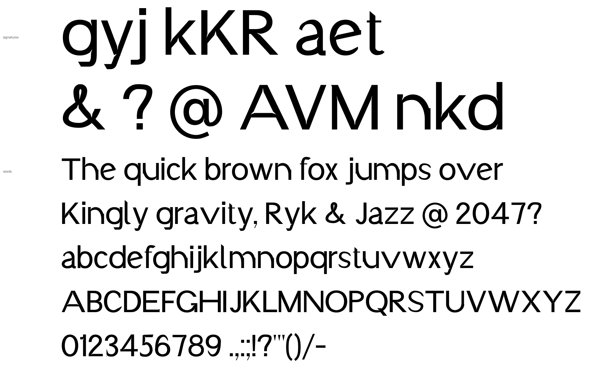
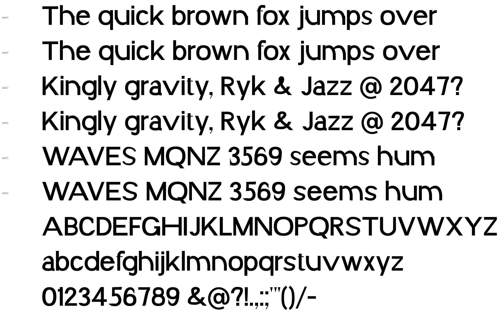

# Ductus Notch — design log

An ink-trap grotesque, designed by eye. No reference was fitted: it starts
from the kit's neutral defaults with the grotesque terminal set. So, unlike
Ductus Sans, it carries no licensing question.

## 01 — first draft: traps by rule, the signatures

**Ink traps are a rule, not a construction** (`ductus/traps.py`,
`font.traps`). After a glyph is merged, every sharp concave corner of its
outline, where the white wedges into the ink at less than `trap_angle`
(80°), gets a triangular notch:
- its mouth sits on the two edges, `trap_mouth` (26) from the corner;
- its tip goes `trap_depth` (44) into the ink along the bisector.

So the n's and m's crotches, the d, b, p and q lobe joins, the insides of
v, w, A, M, N and V, and the forks of k and K are trapped without touching
any construction. `"skip"` leaves the commas and quotes alone, since their
dot-to-tail joint is no crotch. The stems lint measures the outline before
the traps (`CompiledGlyph.untrapped`).

**Weight.** A monoline face from three numbers in `font.py` (stem 92,
thin 78, capital stem 98): every thin and thick part is derived from them.
Other settings:
- x-height 548;
- arches with little contrast;
- curved stroke ends cut on a slant (the `sans_cut_*` angles).

**Signatures** (new `kit.define` options and controls, all defaulting to
the old outlines; the other faces are unchanged glyph for glyph):
- **Flat-footed descenders:** `g_tail="foot"` and `y_tail="foot"`
  (`y_foot_r`). g, j and y turn a tight corner into a level flag to the
  left.
- **Branched k and K:** the leg springs from the arm, away from the stem.
  That gives a Y with two trapped crotches (values only: `k_leg_x0` and
  `k_leg_y0` on the arm).
- **R:** its leg springs from the stem under the bowl, not from the bowl.
- **The angled bar:** `e_bar_tilt` (12°; the e's aperture follows the
  bar). The a's straight top rises to match (`a_bt_tilt`).
- **t:** its top cut at 50° (the face's own `t_top` terminal,
  `sans_cut_ttop`).
- **& ? @:**
  - a one-stroke looped & (`amp_style="stroke"`);
  - a ? at full weight to its end;
  - an upright @ whose inner stem runs on into the ring
    (`at_style="hook"`).

**Spacing and kerning.** Side bearings are set by eye (f, r, L, t, T, j,
J). Kerning is optical, from these outlines, with no house style:
`ductus kern examples/notch/font.py`.

Self-critique, for the next round:
- the capitals are spaced tight, and the A's trapped crossbar is busy;
- the a's tilted top reads oddly at small size;
- the G's jaw trap looks like an arrow;
- C, S, c and s ends are a little sharp;
- the figures are plain;
- it covers 66 glyphs: no accents yet, no Bold.

## 02 — more modern: a second attempt

The user found draft 1 weird. It had too many quirks at once:
- tilted e and a bars, flat-footed descenders, the R's leg from the stem;
- a light weight with airy spacing, and slanted stroke ends;
- traps that read as thin slits.

Draft 2 moves toward a contemporary neo-grotesque:
- **Weight:** medium (stem 112, thin 98, capitals 118), with a big x-height
  (560) and compact widths.
- **Shape:** slightly squarer bowls (fullness 0.66), level stroke ends
  (the kit's grotesque cuts), and the f's hook cut square.
- **Traps:** shallow and clean (30 deep, mouth 24): functional at small
  sizes, a quiet detail large. The G is skipped, because its jaw meets the
  bowl at an acute angle that a trap turned into an arrowhead. Its bar also
  sits a little higher (`G_bar_y` 0.5) and its jaw 8 units out
  (`G_jaw_dx`), so at this weight the jaw stands clear of the bowl's wall
  and the bar.
- **Signatures, fewer and quieter:**
  - the branched k and K;
  - a straight-tailed y (new `y_tail="straight"`: the tail runs on to the
    descender and stops on a level cut);
  - the hooked @ and the looped &;
  - a plain single-storey g and a hooked j.
- **Dropped:** the tilted bars, the flat feet, the stem-sprung R and the
  slanted t top. Their kit options remain for other faces.

Self-critique:
- the C's lower terminal tapers;
- the t's curled tail is a little old-fashioned beside the rest;
- the 1's arm is thin;
- still 66 glyphs, Regular only.

## 03 — rough edges from overlapping strokes

The user found draft 2 interesting but rough where strokes overlap. A scan
of the outlines before traps (corners with a neighbouring segment under
14 units, needle spikes) plus 4× zooms of every hit found three kinds of
fault.

**Leftovers a few units long**, where one stroke ends inside another just
off its edge: steps in U, z, Z, 2, 6, 7 and 9, the e's bar end, the t's
tail and the Q's tail, and spikes in m, u and M. A new rule fixes them
wherever they occur (`ductus/tidy.py`, `font.tidy = {"step": 16, "spike":
150}`, run after merge and before the traps):
- two corners joined by a segment (straight or curved) shorter than `step`
  collapse into one point;
- a needle spike between two straight edges is removed.

Anything longer is left as design.

**Traps where there is no crotch.** The rule now also asks for:
- a white angle of at least `min_angle` (30°), since narrower crotches,
  like the M's, are already slivers and a trap there read as a crack;
- both edges of the crotch to run at least `min_edge` (1.5 mouths, measured
  along the edge to its next corner).

A, G, e, f, 8 and Q are skipped by name: their acute corners belong to a
counter, a tail or a bar, not to two strokes.

**Joins that don't line up at this weight** (construction values):
- **n, h, m, u:** the legs started (`n_leg_top`, `u_leg_top` 0.7 now)
  where the arch was still curving, so the leg's square corner stood out
  27 units as a shelf.
- **m:** the second arch is set onto the first leg below its shoulder
  (`m_join_dx` −20; the first arch's outer curve showed as a hairline).
- **N:** the diagonal is kept within the stem at the top (`N_dx0`).
- **W:** its middle apex is trimmed level (new kit control `W_apex_trim`,
  default 0: the thin stroke's square end poked above the cap line).
- **e:** the bar runs into the bowl's wall (`e_bar_rin` −20; it stopped
  short, leaving a hairline slit).
- **c, e, C:** lower terminals cut clear of the heavier bottom wall (they
  waved or ended in a tip).
- **3 and 5:** lower ends cut level (`sans_cut_fig_low` 90; the 3's cut
  left a sliver below the baseline).
- **s and S:** an even spine (`s_ends` 0.9; the serif's spine thinned its
  ends to 60%).
- **6 and 9:** hooks to 70% weight at their ends.
- **G:** the bar raised and the jaw moved out.
- **&:** a wider loop, so its counter stays open.

Self-critique: the u's right join still has a small corner. The 9's
counter meets its hook in a sharp crotch, which reads as intended with the
trap but is busier than the 6. Still 66 glyphs, Regular only.

## 04 — the leftovers, and the full character set

**Leftovers from 03:**
- **t:** a short level tail with a square end (`t_tail` 130, `t_end_dir` 0,
  `t_end_w` 1, `sans_cut_t` 0).
- **1:** its arm at full stem weight.
- **u:** a sturdier join (`u_join_thin` 90).
- **9:** its hook leaves the bowl lower (`nine_root_y` 0.4).

**The full set:** 183 glyphs, the same as Ductus Sans (accented letters,
ı, æ œ ø ß, Æ Œ Ø, the spacing marks, * % · # $ + < = > [ \\ ] ^ _ { | } ~
… • ° × € £ ¢ – — ‘ ’ “ ” ¿ ¡).

The kit's defaults for the marks and symbols are a high-contrast serif's
hairlines, so a `marks` and a `symbols` block derive them from the face's
weight numbers:
- the acute and grave are heavier;
- the circumflex legs and the ~ mark are at 80% of the thin stroke;
- the dieresis dots are smaller and spaced wider, and the ring is heavier;
- the cedilla is the two-stroke `ced_style="tick2"`, with this face's own
  values;
- the math signs, brackets, braces, bar, underscore, caret, #, %, °, $ and
  * sit at 75–85% of the stem or thin weight;
- the math signs and ~ are larger for the big x-height.

Lint clean, re-kerned (5,651 pairs over 147 glyphs).

Self-critique: the set has no « » guillemets (no face has them yet). The
math signs could sit a touch higher. Still Regular only.
