# Ductus Sans

A grotesque sans-serif built with the same compiler and the same kit
(`ductus/kits/serif.py`) as Ductus Display. It is matched to Geist Sans
(OFL-1.1, Vercel): values are tuned from overlays and the bench's IoU, then
rounded. No outlines are copied.

Source: `examples/sans/font.py`. Sheet: `docs/sans/NN.png`
(`python examples/sans/make_sheet.py NN`). Kerning: `ductus kern
examples/sans/font.py` writes `examples/sans/kerning.json`. Reference:
`python benchmarks/geist_sans/fetch_reference.py`; it is git-ignored and
used for measurement only.

## 01 — a sans from the serif kit

The kit's constructions are style-neutral: arches, a and b lobes, bowls,
the s spine, diagonals, the cap bowls, composites, spacing and auto-kerning.
The serifs live in the **terminal set**. So the sans is mostly three
changes:

1. **`kit.sans_set(P)`**, a new terminal set with no serifs. Stems end
   square; diagonals, apices and vertices are cut flat (horizontally).
   Curved strokes' ends are cut at `sans_cut_*` angles.
2. **Monoline values**, measured off Geist Sans: stem 84, horizontals and
   former hairlines about 76, round sides × 1.05, and the joins and lobes
   at near-stem weight. Several of the kit's ranges were widened to allow
   them.
3. **Grotesque options**, new structure choices in `kit.define`:
   - `g_style="single"`: the single-storey g (the d's lobe on a stem that
     runs into a hook).
   - `l_style="tail"`: the l turns into a tail, as the t does.
   - `J_style="base"`: the J turns along the baseline and back up.
   - `R_leg="curve"`: the leg bends down to stand upright.
   - `Q_style="bar"`: a straight bar across the bowl's lower right.
   - `dot_square`: rounded-square dots.
   - `colon_dy`: the colon's upper dot set lower.
   - `N_dy`: the N's diagonal and right stem stand on the baseline.

The values were then fitted by the same coordinate searches as the serif.
Each glyph's parameters were searched against Geist Sans: weights first,
then the lowercase, capitals, figures, punctuation, symbols, accents and
Æ Œ Ø ß. Side bearings come from Geist Sans's, and the word space is
250 u. Kerning comes from the optical kerner with its default settings
(6,590 pairs; no style weights yet).

**A kit bug found on the way.** The B's two bowls each kept only half a
hairline at the waist, so their counters met and the waist pinched to a
point at the stem. Each bowl now keeps a full hairline wall. That took the
sans B from 0.89 to 0.95 and the serif's from 0.93 to 0.95.

Against Geist Sans: all 175 glyphs 0.912, the 52 letters 0.937. Weakest:
- standalone cedilla 0.38 (ç and Ç are 0.89–0.90);
- £ 0.61, ~ 0.72, 7 0.76, ^ 0.77;
- @, ? and g 0.79–0.80;
- { } and & 0.81–0.82; 8 0.82.

The sans font is linted, compatibility-swept and checked at its range
extremes in the test suite, alongside the serif.

## 02 — the weakest glyphs, and Geist's kerning style

**Glyphs.** New kit options, each fitted against the reference:
- `eight_overlap`: the 8's bowls now meet in a shorter waist;
- `seven_style="curve"`: the 7's diagonal is a bowed pen stroke, with no
  face wedge under the bar;
- a parameterised £: foot, rise, top, ear end, bar extent and base weight;
- `gs_dfar` for the single-storey g's bowl.

The searches also covered ~ ^ ç ? @ { } &.

| Glyph | Before | After |
|---|---|---|
| ? | 0.79 | 0.93 |
| 8 | 0.82 | 0.93 |
| 7 | 0.76 | 0.88 |
| £ | 0.61 | 0.84 |
| & | 0.82 | 0.83 |
| g | 0.80 | 0.81 |
| standalone cedilla | 0.38 | 0.46 |

The cedilla is a 60-unit mark, so a few units of offset cost a lot of
IoU; ç and Ç are 0.87–0.89. Mean IoU over all 175 glyphs rose from 0.913
to 0.916.

The overlays show ~ ^ @ and { } (0.74–0.81) already following the
reference closely. What remains is stroke-end angles and a slightly
different ~ curve.

**Kerning style.** Geist Sans kerns heavily: 2,525 of the 4,624
letter/punctuation pairs measured. The display serif kerns far fewer. The
per-glyph style weights in `kern_style.json` (`[as left, as right]`) are
least-squares fits to Geist Sans's kerning, regularised toward 1. Generated
with `ductus kern examples/sans/font.py --clearance 60 --min-abs 5`, giving
9,094 pairs.

| Agreement with Geist Sans | Correlation | MAE |
|---|---|---|
| Letter pairs, before | 0.57 | 14.8 u |
| Letter pairs, now | 0.68 | 12.1 u |
| All pairs, before | 0.56 | 11.6 u |
| All pairs, now | 0.71 | 8.9 u |

Key pairs, ours / Geist:

| Pair | Ours | Geist |
|---|---|---|
| To | −70 | −80 |
| AV | −105 | −106 |
| P. | −110 | −110 |
| Yo | −75 | −70 |
| Wa | −50 | −44 |
| TA | −65 | −90 |
| LT | −95 | −140 |

The words comparison against Geist Sans is not committed, because renders
of the reference stay out of the repo. To regenerate it, run
`tools/fitting/cmpw.py`. Geist also tucks a
few pairs our profile kerner leaves alone, such as rn −40 and Fl −20.

## 03 — judged large: structural fixes, and kerning with per-side bias

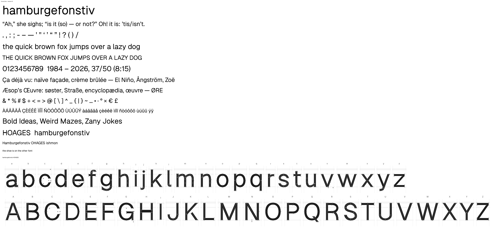

**How the problems were found.** The words were rendered at 200–500 px
beside Geist Sans (`tools/fitting/look.py` and `vlook.py`; the renders
stay in scratch). Several glyphs with decent IoU had visible defects:
- the 6 and 9 ended in a serif's wedge face;
- the d, q, g, b and p had V notches and an S-wave crown where a lobe
  hung on the stem;
- the y had a white hairline through its tail;
- spikes poked past the baseline or cap height on N and W;
- the r ended in a thin beak, and the t and l tails curled up;
- the G had a stub, and the U a dent.

**New kit options**, so the serif keeps its own constructions:

| Option | Glyphs | What it does |
|---|---|---|
| `fig_ends="cut"` | 6 9 | The hook turns down and ends in a plain cut. Its root is a parameter and never steps out past the bowl. |
| `one_style="arm"` | 1 | A curved arm instead of a diagonal flag. |
| `face_serifs=False` | 2 E F L T Z z 7 Æ Œ G | No vertical-face wedge serifs, and no beard on the G. |
| `d_style="bowl"`, `b_style="oval"` | d q g, b p | An oval overlapping the stem. The g's bowl sits higher (`gs_bowl_b`). |
| `a_style="bowl"` | a | A tilted oval, with Geist's square spur at the stem's foot. |
| `y_left="poly"` | y | The thick arm is a parallelogram, so no flat cut crosses the tail. |
| `level_trim` | A K M N V W X Y Z k v w x z | Cut level at the baseline and cap/x-height. |

The 2's diagonal is trimmed at the base's left end in both faces.

**A compiler bug.** Cuts were filled together by winding number. Two
overlapping cuts drawn in opposite directions therefore cancelled where
they overlapped, and left ink there. The N's diagonal clip lost its
fragment that way in both faces. Cuts are now unioned one by one. Only 6 of
379 glyphs across the three fonts changed (N and Ñ in both faces, and
sub-unit changes to the serif's G and d).

**Values.**
- The r's arm and the t and l tails keep their full weight to a level end.
- The e's aperture cut is flatter and its bar runs flush with the bowl.
- The J's ranges now cover the baseline hook (the sans sat outside them,
  so fits could not move it).
- The W is narrower (its width range now goes down to 700).

Per-glyph IoU, before → after:

| Glyph | Before | After |
|---|---|---|
| d | 0.91 | 0.98 |
| q | 0.89 | 0.98 |
| g | 0.81 | 0.95 |
| b | 0.94 | 0.98 |
| p | 0.93 | 0.97 |
| 6 | 0.88 | 0.95 |
| 9 | 0.85 | 0.94 |
| 1 | 0.89 | 0.96 |
| J | 0.78 | 0.97 |
| W | 0.89 | 0.96 |
| l | 0.92 | 0.96 |
| r | 0.91 | 0.94 |
| a | 0.86 | 0.90 |

Mean IoU over all 175 glyphs: 0.916 → 0.923.

**Kerning.** The style weights only scale our optical measure, so pairs it
sees as neutral (rn, xo, Fl) could not be kerned. Each glyph's style can now
carry two more numbers, a bias as left glyph and a bias as right glyph,
added to its pairs' kerns. These act like the class kerns a type designer
sets. Punctuation-only pairs take none.

The fit (`tools/fitting/kstyle.py`) regularises the biases toward 0.
On 30% of the pairs held out of the fit, correlation with Geist's kerning
went from 0.615 (weights only) to 0.760.

| Agreement with Geist Sans | Iteration 02 | Now |
|---|---|---|
| All pairs, correlation | 0.705 | 0.826 |
| All pairs, MAE | 8.9 u | 7.0 u |
| Letter pairs, correlation | 0.676 | 0.817 |

Ligatures now kern as their outer components do, which closes the
f + f_i gap. The legacy `kern` table keeps the strongest 10,920 pairs, its
format's limit; GPOS carries all 16,030. Generated with `ductus kern
examples/sans/font.py --clearance 60 --min-abs 5`.

**Still to do.**
- The a's bowl top is a curve where Geist's is a straight diagonal.
- The U has a slight notch where its cup meets the right stem (visible
  above about 300 px).
- ß, & and @ differ in shape.
- The braces have a notched beak.
- # and < > differ in width.
- ¿ and ¡ are missing.
- The ff join leaves a slight gap.

## 04 — the a, the braces, the ß, and ¿ ¡

Each was rebuilt to Geist's construction, read from its outline points,
rather than tuned within the old one.

**a.** `a_style="stroke"`: the bowl is one pen stroke. It runs from inside
the stem along a straight top that rises about 10° into the stem, round the
left side and the bottom, and back into the stem near the baseline. The old
oval could only give a curved top. a 0.90 → 0.94.

**Braces.** `brace_beak="point"`: the arms reach the beak at an angle
(`brace_beak_a`). A filled beak continues their edges from each stroke's
square end: the outer edges meet in the tip, and the inner ones in a notch.
Before, two level square ends stacked into a blunt, notched rectangle. The
arms stop at least half their width ÷ tan(angle) short of the midline, so
the beak is valid at every setting. { } 0.81 → 0.90.

**ß.** `ss_style="bar"` takes two strokes:
- the upper bowl comes down into a level bar that stops short of the stem;
- the lower bowl starts from that bar and ends in a level foot, cut square.

ß 0.83 → 0.945.

**¿ ¡.** A new composite, `font.turn(glyph, base, dy)`, turns a glyph 180°
about its ink and moves it `dy` up. The side bearings swap, and the
contours keep their direction. ¿ and ¡ are ? and ! hung `inv_dy` (−162)
lower, as in Geist. Added to both faces.

**Also fixed on the way:**
- **t and l:** the feet were slightly wavy (the end sat above the tail's
  lowest point). `t_bot_dy` and `l_bot_dy` raise the lowest point, so the
  foot is level: t 0.971 → 0.991, l 0.963 → 0.984.
- **g:** the hook's end was a flick. It now rounds a wider bottom
  (`gs_bot_x`, `gs_t`) to an end cut nearly across the stroke, with its own
  terminal tag (`g_end`, `sans_cut_g`), separate from the y's tail. g 0.95
  → 0.96.

Mean IoU over all glyphs: 0.923 → 0.926. Kerning was regenerated: 16,442
pairs, agreement with Geist Sans correlation 0.826, MAE 6.9 u.

**Still to do.**
- The j's hook end curls; Geist's is a level foot.
- The f's hook end has a tick.
- The parentheses end in points where Geist's are cut level.
- The a's join with the stem is a little heavy, where Geist has a thin
  crotch by the spur.
- & and @ differ in shape; # and < > differ in width.

## 05 — the j, the f and the parentheses

**j.** `j_style="foot"`: the stem turns into a level foot along the
descender, cut square at the left, as Geist's does. It replaces the hook
that curled up into a tip. It is the t's tail mirrored below the baseline:
`j_foot_y`, `j_foot_x`, `j_t`. j 0.946 → 0.957.

**f.** The hook had a pinch on its underside: `f_top_dw` (−22) thinned the
stroke at the top of the arc. Its end also ran almost straight down
(−84°) into a cut, which left a tick. The hook is now even, and ends at
−20° in a vertical cut (`sans_cut_f` 0). f 0.964 → 0.973. In "ffi" and
"off" the hooks now read like Geist's.

**Parentheses.** `paren_ends="level"`: both ends take the `paren_end`
terminal, which the sans cuts level, as Geist's are cut. Before, they were
cut across the stroke and came to points. ( ) 0.907 → 0.923.

Mean IoU over all glyphs: 0.926 (0.9258 → 0.9261). Kerning was
regenerated: 16,485 pairs, agreement with Geist Sans correlation 0.825,
MAE 7.0 u.

**Still to do.**
- The parenthesis ends taper (`paren_end_w` 0.6) where Geist's keep
  more weight.
- Dots are rounded squares where Geist's are square, though square dots
  scored lower.
- The a's join with the stem is a little heavy.
- & and @ differ in shape; # and < > differ in width.
- Geist uses no fi ligature; ours joins the f's hook to the i.

## 06 — leftovers: the a's foot, & # < >, square dots, no fi ligature

- **a.** Geist's stem doesn't stand on the baseline with a spur added. It
  turns at its foot into a short level foot, cut square: the t's tail in
  small (`a_turn`, `a_tail`, `a_foot_dy`). That leaves a V notch where the
  bowl meets the stem, so the join no longer looks heavy. a 0.942 → 0.953.
- **&.** `amp_style="branch"` uses Geist's construction:
  - a straight diagonal from the leg up into the top loop;
  - round the loop, down through the crossing into the lower bowl, and
    back into the diagonal;
  - the arm, a short stroke branching off the diagonal and cut level.

  The old single stroke made the arm the lower bowl's right side.
  & 0.83 → 0.914.
- **#.** The bars now follow the slant (`hash_bar_shift`). The verticals'
  formula centred the pair half a stroke to the right of the bars; that
  bug is fixed for both faces. # 0.853 → 0.992.
- **< >.** `chevron_style="level"`: one polygon, with the arms cut
  vertically and a flat vertical tip, as Geist's are. 0.833 → 0.978.
- **Dots.** `dot_style="square"`: sharp squares sitting on the baseline,
  with no overshoot. The bullet stays round. Period and ellipsis
  0.848 → 0.983, ! 0.946 → 0.970, ? 0.928 → 0.947.
- **fi.** `ligatures=False`: Geist sets f and i apart, and so does the sans
  now.
- **@.** The ring no longer steps out below the inner stem (`at_root_dy`).
  @ 0.796 → 0.823. The rest of the gap is that Geist's inner a leans (an
  italic a inside an upright ring); not done.

Mean IoU over all glyphs: 0.926 → 0.931. Kerning was regenerated: 16,127
pairs, agreement with Geist Sans correlation 0.823, MAE 7.0 u.

**Still to do.** The weakest are now marks and small symbols: the
standalone cedilla (0.46), ~ (0.74), ^ (0.77), @ (0.82), =, the quotes and
comma (0.83–0.84), £ (0.84).

## 07 — a variable weight axis (SPEC M3, started)

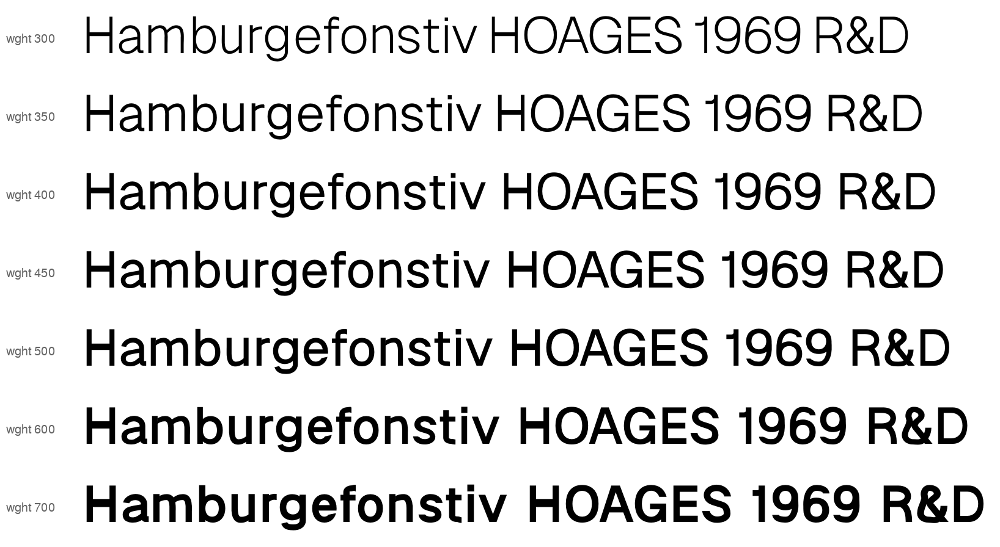

`ductus build examples/sans/font.py --variable` writes a CFF2 variable font
with a `wght` axis from 300 to 700. It has named instances Light, Regular,
Medium, SemiBold and Bold, and all 182 glyphs vary. The ramp above is that
font instantiated at seven weights, including in-between ones no master
defines.

**Masters.**
- Light is the regular with every stroke thickness ×0.7, and Bold ×1.45
  (`kit.weight_master` over `kit.WEIGHT_PARAMS`). Ratios, tensions,
  positions and glyph widths are left alone.
- A few gaps grow with the strokes they separate, so the white between
  them stays (`WEIGHT_GAPS`: the quotes, ellipsis and diaeresis).
- In the &, the waist's offset from the crossing and the lower bowl's
  offset from the diagonal scale with the weight. At ×0.7 the strokes
  otherwise stopped overlapping and the counters opened.

**Compatibility.** The raw strokes are point-compatible by construction.
The merged outline is not: as strokes thicken, overlap removal and cuts
re-segment the curves, which changed the structure of 40 glyphs at ×0.7
and 55 at ×1.45. `ductus/compat.py` unifies the masters exactly:
1. Contours are matched between masters.
2. Each master's corners are aligned to the reference's, using position
   and in/out tangents, by dynamic programming over cyclic offsets.
3. Between aligned corners, every segment becomes a cubic and segments are
   split by de Casteljau at a shared set of arc-length positions.

Shapes are unchanged (area identical); only the point structure is
matched. It refuses real topology changes, such as a counter opening; the
&'s at ×0.7 was one, found this way and fixed in the design. Master
charstrings are written unoptimised, because the CFF optimiser turned
straight curves into lines in one master only.

**Not yet.**
- The Bold is only the regular made heavier:
  - glyph widths and side bearings don't grow, so it sets tight;
  - counters close up in a e s;
  - the t's foot kinks.

  A real Bold master needs its own widths, spacing and a few structural
  values; the axis machinery takes any param overrides per master.
- Kerning is the regular's, static, at every weight.
- The display serif has no axis yet.

## 08 — a designed Bold (and Light)

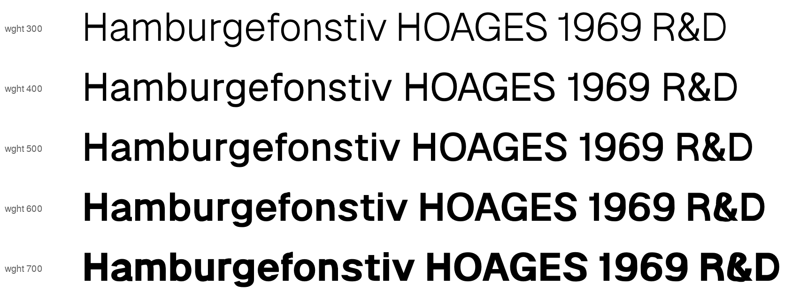

Geist Sans Bold and Light were fetched for measurement only (git-ignored,
like the Regular). Geist's Bold is not the Regular scaled:

| | Light | Regular | Bold |
|---|---|---|---|
| Stems | 66 (×0.79) | 84 | 150 (×1.79) |
| Horizontals | 63 (×0.79) | 80 | 119 (×1.49) |
| n / o side bearings | 82 / 46 | 80 / 44 | 66 / 37 |

The Bold thickens its horizontals less than its stems, which keeps the
counters open. Its glyphs are wider, its side bearings tighter, its
x-height 6 units taller, and its word space narrower (228 against 250).

**Masters now carry a design.**
- `kit.weight_master(params, k, kh)` scales stems by `k` and horizontals
  (`WEIGHT_H`) by `kh`.
- A master's own values and per-glyph side-bearing deltas live in
  `examples/sans/master_bold.json` and `master_light.json`.
- `variable.compile_master()` applies both.

**Fitting** (`tools/fitting/mfit.py`, `bold.sh`, `bold2.sh`). Each master
is scored against the matching Geist weight. Candidates are refused if they
change any glyph's contour count, so the masters stay interpolable.
1. Weights and proportions on the core letters (stem 150, hairline 118,
   x-height 536).
2. Every glyph's width.
3. Dots and marks.
4. The t and l tails: longer, with wider turns at Bold.
5. The a.
6. The ring.
7. The @: at ×1.79 its ring touched the inner stem and enclosed a sliver.
8. Respacing toward Geist Bold's side bearings, and the space set to 228.

| Master | Score against the matching Geist weight |
|---|---|
| Bold | 0.820 → 0.880 |
| Light | 0.887 → 0.890 |

All 182 glyphs stay compatible across the three masters.

**Still to do.**
- Kerning is the Regular's at every weight; Bold lines run slightly long.
- The Bold's weakest glyphs are marks and symbols (", cedilla, bullet, °,
  quotes, ~, _).
- The Light got only a short pass.

## 09 — the Bold's arches (n m h u r)

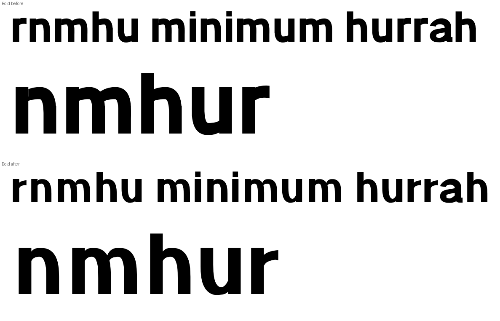

The Bold's arch tops were too heavy, and the r's arm was a thick flag.
Close-ups against Geist Bold showed several causes:

- **The arch nib kept the Regular's contrast.** A pen's thin width is a
  share of its thick one, so the thin parts scaled with the stems (×1.79)
  instead of the horizontals (×1.49). `kit.weight_master` now adjusts every
  `*_contrast` so the thin width follows `kh`. The join thicknesses
  (`n/u/r_join_thin`, `d_lobe_thin_b`) moved into `WEIGHT_H`.
- **A lopsided counter.** The shoulder sat far right (`n_shoulder_x` 0.625).
  At Bold the thick nib can't follow so tight a turn, so the counter rose
  in a straight line and then turned sharply into the leg. Bold now uses
  `n_shoulder_x` 0.52, `n_tension` 0.85 and `n_join_angle` 65.
- **A hook where the arch met the leg.** The leg stem's square top stood
  above the point where the arch turns vertical, so it cut into the curve.
  Bold now uses `n_leg_top` 0.5, so the stem starts where the arch ends,
  and `n_out_y` 0.7. The u had the same problem mirrored (`u_leg_top`).
  Its cup nib is now level (`u_angle` 0), which removes a dimple at the
  join.
- **A 1-unit crack.** `head_inset_cut` ran even with `head_inset` 0 and
  left a 1-unit slit between the stem and the arch (n, m, r). It was
  invisible in the Regular but showed in the Bold. With no inset, the cut
  now sits above the glyph and removes nothing. It isn't skipped, because the
  outline structure must not depend on a parameter's value. The Regular's score is unchanged (0.9311).
- **A tooth on the m.** Its second arch joined the first one's leg while
  that leg was still curving. The new kit parameter `m_join_dx` (default 0;
  −20 at Bold) moves the join onto the curve.
- **The r's arm.** It now leaves the stem lower (`r_join_at` 0.62, angle
  65), with a long taper (0.9) and a level end (`r_dir` −5). The underside
  is now a smooth concave curve.

These choices were made by eye. The fitter preferred the old shapes on
IoU: n/m/h/u lost about 0.03 each, and the Bold went from 0.8804 to
0.8800 against Geist Bold. Light stays at 0.8903. A refit of the arch
widths found nothing better.

**Self-critique.** The u's bowl is still a little flat on the right where
it meets the stem. The Bold also sets slightly wider than Geist Bold.

## 10 — the Bold's s, r, v, w

At Medium and Bold the s, r, v and w still looked wrong. Geist Sans Medium
and SemiBold are now fetched too, for measurement only, so the Medium can be
checked against the real thing.

The Medium matched Geist Medium closely. It only carried the Bold's faults
at half strength, so the fixes are all in `master_bold.json`:

- **s.** The stroke was too heavy for its tight turns. The inner offset
  folded where the bowls turn, leaving kinks inside them. These read as
  facets and nubs, and the Medium inherits them. Fixes:
  - rounder sides (`s_left_t`/`s_right_t` 0.85);
  - the top node moved right and the bottom node left (0.55 / 0.45),
    which widens the turns;
  - terminals refit lower and higher (`s_t1_y` 0.68, `s_t2_y` 0.315).

  The s goes from 0.872 to 0.944 against Geist Bold.
- **r.** The arm is higher and thicker (`r_y` 0.875, `r_end_w` 1.15), with
  a shorter taper. A fit pushed `r_dir` to −11, which put a wave in the
  arm's top edge; it is kept at −6. The r scores 0.943 (was 0.927).
- **v, w.** Diagonal thicknesses and vertex height were refit. The w is
  narrower (662).

The Bold scores 0.8800 → 0.8816 against Geist Bold.

**Self-critique.**
- The s keeps a short vertical flat inside each bowl. It is invisible at
  text sizes.
- The e's terminal is still a wedge where Geist cuts it level.
- Lines still set slightly long at Medium and Bold.

## 11 — the r is the n's arch, cut square

The Bold r still looked wrong: its arm was a flag rising in a straight
diagonal from a deep notch. Geist's r is the top of its n: the arm leaves
the stem at the top, rounds over a shoulder level with the x-height, and
ends in a square cut. A single curve from the join can't make that shoulder.
A steep start makes the thick pen bulge above the x-height.

New kit option `r_style="arch"` (the sans uses it; `"ear"` is the default,
so the serif and the benchmark are unchanged). The r draws the n's arch,
with its own values where Geist's r differs from its n:

- width `n_width + r_arch_dw` (the arch is wider, so the cut lands on the
  level part of the shoulder);
- its own join (`r_join_at/thin/angle`), lower than the n's, which gives a
  smooth concave underside;
- its own taper (`r_taper_len`): the taper is a share of arc length, and
  this arch is much longer than the n's;
- extra weight at the shoulder (`r_arch_sdw`), kept inside the x-height.

The arch is then cut square at `r_width`. `arch()` gained `shoulder_dw`,
`taper` and `join_at` arguments; their defaults leave n, m and h unchanged.

| r | ear (before) | arch |
|---|---|---|
| Regular vs Geist Regular | 0.943 | 0.9348 |
| Bold vs Geist Bold | 0.943 | 0.932 |

The IoU is a little lower, but the outline now follows Geist's at every
weight. Mean IoU: Regular 0.9311 → 0.9310, Bold 0.8816 (unchanged),
Light 0.8903 → 0.8904. Kerning re-run.

**Self-critique.** The Bold a's counter looks pinched in words ("rar").
That is next.

## 12 — the Bold a, and the e and c terminals

**The a.** In words the Bold a still looked odd. Measured against Geist
Bold:

- **Hood:** its pen was angled 36°, which keeps its top heavy, so the upper
  counter was about 35 units short. At Bold `a_hood_angle` is now 10 and
  `a_hood_thin` 1.0.
- **Bowl counter:** Geist's is a lens whose point meets the stem at about a
  third of the x-height, like the Regular's. A D-shaped counter (a steep,
  low join) was tried and rejected: it doesn't match Geist. The counter is
  now matched to Geist's by its box. New kit parameters, all default 0:
  - `a_bl_dw`: width at the bowl's left node;
  - `a_bb_dw`: width at its bottom node, outer edge kept on the baseline;
  - `a_bt_dw`: width at the bar's stem end.

  At Bold they are +15, +8 and −30, with `a_bl_x` 91, `a_bt_y` 300, and
  the join at 170 / 65°, bottom node 290. The rendered counter is now
  2,974 px against Geist's 3,006, with the same box.
- **Foot:** it turns later (`a_turn` 160, `a_tail` 120), so it flicks out
  instead of stepping.

The a scores 0.919 against Geist Bold (0.904 at the start).

**e and c terminals.** Our e and c ended in wedges whose tip sat on the
bowl's outer edge. Geist truncates the tip with a short, near-vertical face.
New kit option `ec_aperture="vertical"` (default `"tip"`) adds that face
cut at `width * e_vcut_x` / `c_vcut_x`, leaning `*_vcut_dx` units at the
top. The sans uses it at every weight:

| vs Geist | before | after |
|---|---|---|
| Regular e / c | ~0.955 | 0.973 / 0.961 |
| Bold e / c | ~0.91 | 0.944 / 0.954 |

The s was checked too: its level terminal cuts already sit on Geist's.

Mean IoU: Regular 0.9310 → 0.9311, Bold 0.8809 → 0.8824, Light
0.8904 → 0.8906. Kerning re-run.

**The kink, fixed.** The Bold a had a small kink at its counter's lower
left. Measured on the bowl's centre line, the left-to-bottom turn had a
radius of 72.8 units at its tightest, but the stroke's inner half there was
about 79, so the inner edge folded. New kit parameter `a_bs_bias` (default
0.5) sets the share of the stroke's extra (thick minus thin) weight on the
counter side. At Bold it is 0.2, which puts the weight outside the curve,
and the bowl was refit under a no-fold constraint. Refit values:
`a_bl_x` 99, `a_bl_y` 147, `a_bl_dw` 5, `a_bb_x` 274, `a_bb_dw` 12,
`a_bt_dw` −25, `a_bs_thick` 144.7, `a_bs_t` 0.82. The counter's outline is
now smooth at Bold and Medium. The a scores 0.916 against Geist Bold (0.919
with the kink).

## 13 — cracks, marks, kerning per weight, and the figures

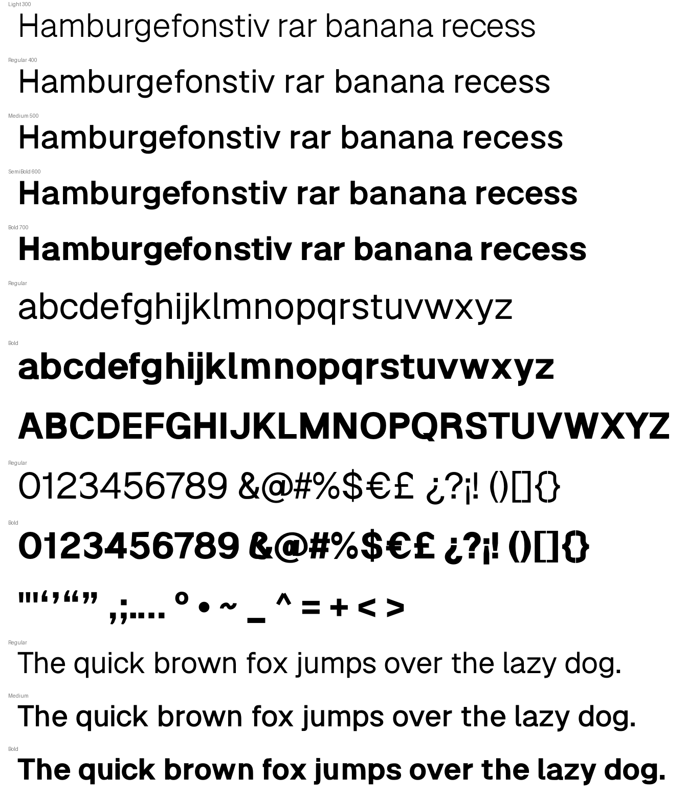

**Cracks.**
- **K:** its leg was a separate contour stopping just short of the arm,
  which left a hairline gap. Geist's leg runs into the arm, so now ours does
  too (one contour at every weight; `K_leg_x0`/`K_leg_y0` refit). Regular K
  0.922 → 0.982, Bold 0.906 → 0.968.
- **£:** its curve ended heading down at a hard-coded −70°, which the cut
  shaved into a needle. New parameter `pound_end_dir` (default −70); the
  sans is refit at both weights. Regular 0.843 → 0.887, Bold 0.789 → 0.880.
- **{ }:** the pointed beak left a cusp at Bold. Geist uses a square tab at
  every weight, so the sans switches to `brace_beak="square"`. Regular
  0.903, Bold 0.919. The 1 was clean.

**Marks and symbols.** At Bold their thicknesses had grown with the stems
(×1.79); Geist thickens them much less. They were refit glyph group by
glyph group with `mfit.py cd`. Two construction changes:
- **Bullet:** a true circle (it inherited the sans's square-ish dot).
- **Comma and quotes:** a square head when dots are square, as Geist does,
  with the tail leaving its bottom edge (new `comma_root`). Regular comma
  0.841 → 0.959, Bold 0.819 → 0.941.

The straight quotes, = and ° were set from Geist's measured sizes after the
fit had widened them. Bold " 0.55 → 0.954, = 0.778 → 0.933.

**Kerning per weight.** `ductus kern --master 700` (and 300) measures a
master's own outlines and writes `kerning_<value>.json`; the sans loads them
into `font.variable["kerning"]`. `build_variable` gives every master its own
values over one shared set of pairs (0 where a master has none), and varLib
merges them into variable GPOS kerning (`tests/test_variable.py`). Bold
lines now set within 0.4–2.0% of Geist Bold's length.

**Figures.** Fitted at Bold (each figure with its own parameters) and at
Regular for 3, 5 and 7:

| Bold | 1 | 2 | 3 | 4 | 5 | 6 | 7 | 8 | 9 |
|---|---|---|---|---|---|---|---|---|---|
| before | 0.736 | 0.900 | 0.838 | 0.828 | 0.787 | 0.918 | 0.837 | 0.835 | 0.907 |
| after | 0.930 | 0.934 | 0.875 | 0.907 | 0.853 | 0.944 | 0.930 | 0.897 | 0.948 |

Regular 7: 0.877 → 0.917.

Mean IoU: Regular 0.9311 → 0.9359, Bold 0.8823 → 0.9077, Light
0.8906 → 0.8964.

**Self-critique.**
- The cedilla's form still differs from Geist's (Bold 0.61).
- The Bold ellipsis' dots are too large (0.66).
- There is no ¢.

## 14 — the cedilla, the ellipsis, and ¢

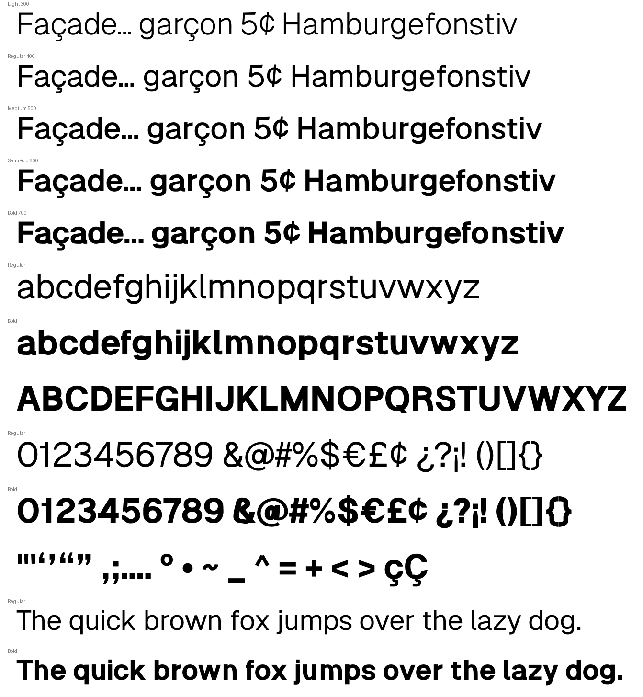

- **Cedilla.** Geist's is a straight tick slanting down-left from under
  the letter into a corner, then a hook round to the left. Ours was one
  smooth curl, which can't make that corner. New kit option
  `ced_style="tick"` (default `"curl"`) draws a line into a corner, then
  the hook. New parameters: `ced_root_dx` (where the tick starts),
  `ced_neck_dir` (the hook's direction out of the corner), `ced_end_x` and
  `ced_t` (default `ced_root_dir`, used by the curl, is also exposed).
  Regular 0.456 → 0.746; Bold 0.614 → 0.796, with lighter stroke widths
  (they had scaled with the stems). At the Light, the corner left a 45 u²
  pinhole, just above the 40 u² drop threshold, which changed the contour
  count. With `ced_neck_dir` −30 it closes at every weight.
- **Ellipsis.** `WEIGHT_GAPS` widened the gap between dots as they grew;
  Geist lets it shrink. At Bold the dots are now 229 apart, as measured.
  Bold 0.66 → 0.939.
- **¢ (new).** Geist's ¢ is its c raised about 90 units, crossed by a
  nearly vertical stroke from −12 to 726. The c's construction became
  `c_body(gl, cut_x, dy)`. The ¢ raises it (`cent_dy`), keeps the aperture
  cut clear of the stroke (`cent_cut_x`), and adds the stroke (`cent_x0/x1`,
  `cent_bot/top`, `cent_t`, which scales with weight). It takes the c's side
  bearings. Regular 0.972, Bold 0.938.

Mean IoU: Regular 0.9359 → 0.9381 (now with ¢), Bold 0.9077 → 0.9107,
Light 0.8964 → 0.8983. Kerning re-run.

**Self-critique.** The cedilla's tick has a pointed top, where Geist's is
cut flat. It is mostly hidden inside the letter.

## 15 — Bold figures and symbols

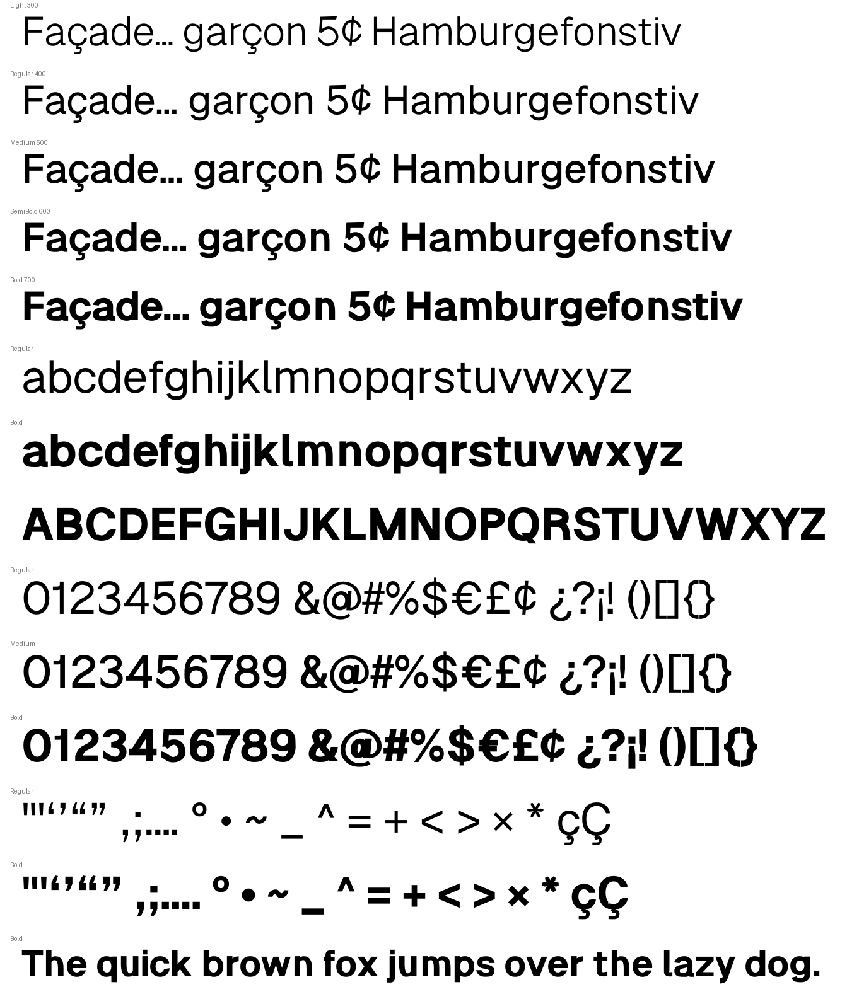

The Bold figures and symbols averaged 0.8966 against Geist Bold. Each weak
glyph was refit over all of its own parameters: stepwise fits first, then a
random joint search where the steps stalled. Construction changes:

- **Opening quotes ‘ “** are the comma turned, so they inherited the Bold
  comma's fitted tail. New quote-only offsets on the tail (`quote_tail_d`,
  `quote_dx_d`, `quote_tip_dw`, `quote_root_d`, default 0). The real fault
  was height: Geist's opening quotes sit about 30 units lower, and
  `quote_bot`'s range (450–620) stopped the fit. It is now 380–620, and the
  Bold uses 415. 0.71 → 0.95.
- **^ with `level_trim`** (the sans): both strokes run on past the apex and
  below the feet, then are cut level, giving Geist's flat apex and level
  feet instead of a notched M. Regular 0.760 → 0.928, Bold 0.830 → 0.921.
- **=** had moved when the + fit changed the shared math height; it gets
  its own `eq_dy`. 0.893 → 0.986.

| Bold | before | after |
|---|---|---|
| ? ¿ | 0.826 | 0.964 |
| & | 0.863 | 0.947 |
| \* | 0.834 | 0.904 |
| + | 0.890 | 0.966 |
| < > | 0.805 | 0.990 |
| _ | 0.872 | 0.913 |
| ¨ | 0.858 | 0.903 |
| ( ) | 0.911 | 0.921 |
| % | 0.831 | 0.862 |

Bold figures and symbols 0.8966 → 0.9249. Mean IoU: Regular 0.9381 →
0.9390, Bold 0.9107 → 0.9226, Light 0.8983 → 0.8994. Kerning re-run.

**Self-critique.**
- The % rings are even-weight, where Geist's have heavier sides (0.862).
- The ~ (0.84), @ (0.84) and € (0.86) remain the weakest symbols. They
  match in outline but not in fine curve.

## 16 — the 3, 4, 5 and 6: terminals and joins

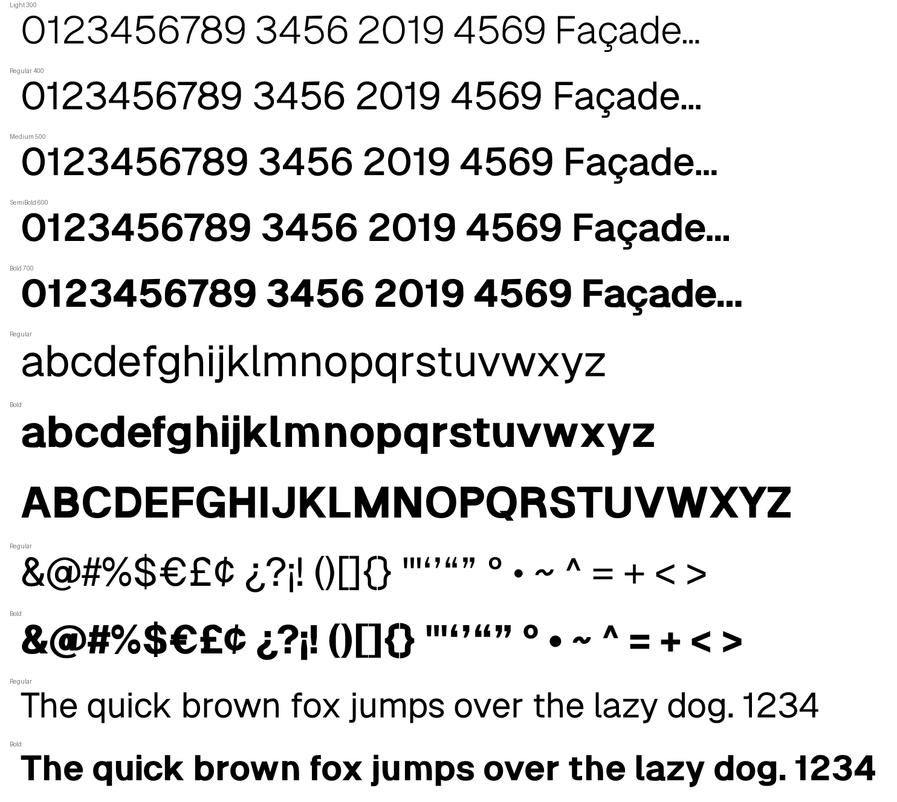

**Terminals.** The 3 and 5 ended in a pointed up-curling flick at every
weight. Geist's lower terminal rises almost vertically at the end and is
cut level across the top, about a quarter of the way up the figure.
- New terminal `fig_low` for the 3 and 5 (used when `fig_ends="cut"`, the
  sans only), with its own cut, `sans_cut_fig_low` (level). They had used
  the `ear` terminal, which the sans also uses for the j and g.
- The shape was set by eye, not IoU: the fitter kept returning flicks,
  which score about the same. Held: the end at 95° with a level cut.
  Fitted: where the end sits and the bowl leading into it.

**Joins** (where the strokes meet):
- **4:** Geist's diagonal comes down flush with the bar's left end; ours
  stopped short, so the bar stuck out. New `four_diag_dx` (moves the
  diagonal's foot) and `four_bar_l` (where the bar starts).
- **5:** the bowl left the stem low and at 40°, so its underside dipped
  below the stem's foot into a V. New `five_start_dy` / `five_start_dir`
  (25 / 25): the foot now runs straight into the bowl's inner edge, as
  Geist's does. The stem's lean and sloped foot, hard-coded at 28 and 20,
  are now `five_lean` / `five_foot_dy`. At Bold the foot is lower (305) and
  `five_w`'s range is widened to 640.
- **6 and 9:** Geist's bowl sweeps up into the hook, which leaves a low,
  sharp crotch. Ours was fuller at that corner, so a wedge filled the
  crotch. `fig_bowl` now takes a per-corner fullness: `six_join_dfull` /
  `nine_join_dfull` (−0.2 Regular, −0.3 Bold) apply only at the corner the
  hook leaves from.

| vs Geist | 3 | 4 | 5 | 6 | 9 |
|---|---|---|---|---|---|
| Regular before | 0.895 | 0.911 | 0.893 | 0.948 | 0.943 |
| Regular after | 0.915 | 0.919 | 0.921 | 0.942 | 0.949 |
| Bold before | 0.886 | 0.917 | 0.867 | 0.944 | 0.948 |
| Bold after | 0.903 | 0.971 | 0.919 | 0.956 | 0.958 |

The Regular 6 dips slightly because its crotch is sharper, which is how
Geist's looks. Mean IoU: Regular 0.9390 → 0.9393, Bold 0.9226 → 0.9234,
Light 0.8994 → 0.8995. Kerning re-run.

## 17 — the 5's step and the % rings

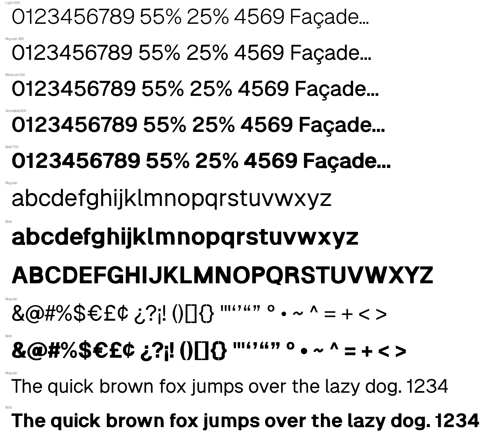

- **The 5's step.** Geist's stem foot is level, and the bowl's underside
  rises straight from its right end. Ours had a sloped foot, which left a
  small step at Regular; at Bold the bowl's underside dipped 31 units below
  the foot into a V. Now `five_foot_dy` is 0, and the bowl starts where its
  underside leaves exactly at foot level (`five_start_dy` 35 Regular, 60
  Bold). This was measured as the dip below the foot just right of the
  stem: Regular −5 → −1, Bold 31 → −1.
- **The % rings.** Their top and bottom used the font's hairline, which at
  Bold (118) outweighed their sides (89): the inverse of Geist's rings,
  which are heavy at the sides and light at top and bottom. New
  `pct_thin_k` scales the rings' hairline: 0.79 Regular, 0.7 Bold. The
  rings are refit at both weights. % Regular 0.884 → 0.936, Bold
  0.862 → 0.932.

Mean IoU: Regular 0.9393 → 0.9396, Bold 0.9234 → 0.9238, Light
0.8995 → 0.8997. Kerning re-run.

## 18 — the Bold 9's lower stroke

The Bold 9's descending stroke slanted down-left from the crotch, so the
gap under the bowl was a narrow diagonal V. Its inner edge also wavered as
the stroke widened, and the terminal had a small notch on its inner side.
Geist's stroke drops nearly vertically and rounds into a bowl-shaped gap,
and its terminal's top slopes into that curve.

- The stroke's lowest point moved (`nine_top_x` 0.42, from 0.49) and its
  end turns to −80°, so it descends steeply and rounds at the bottom.
- The rest of the 9 was refit around that by joint search (root, hook,
  width).

The Bold 9 scores 0.958 → 0.943 against Geist Bold; it reads closer in
words, so it was set by eye. The Regular is unchanged; only the Bold's
kerning was re-run.

**Second pass.** In words the Bold 9 still read differently. Two things,
both measured against Geist's outline:
- **The gap under the bowl** was narrow on its right because the
  descending stroke ran too far inside. A joint search over the hook
  (looser root curve `nine_root_t`, thinner root, new `nine_mid_w` for the
  hook's middle width, default 1) put both its edges on Geist's.
- **The right side wobbled.** Measured as the right edge's x at each height
  against Geist's: ours was up to 7 units wider at the shoulder, then up to
  7 narrower just below where the hook leaves the bowl. Geist's side is
  widest lower, at y≈400. The hook now leaves at the bowl's widest point a
  few degrees outward (`nine_root_dir` 93, `nine_root_y` 0.47), and the
  shoulder corner is less full horizontally. New `fig_bowl` corner
  controls: `*_stem_dh` / `*_stem_dfull` (horizontal / vertical fullness
  at the stem-side corner) and `*_join_dv` (vertical fullness at the
  hook's corner); defaults 0. The edge now stays within 4 units of
  Geist's.

The Bold 9 scores 0.943 → 0.966; Bold mean 0.9237 → 0.9239.

## 19 — glyph-by-glyph refit, round 1

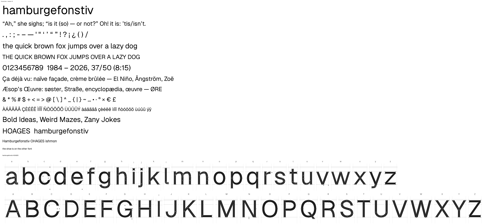

Every glyph was refit on its own, at Regular and then Bold, using the
method from the Bold 9. The order was worst Hausdorff first. Each glyph
went through new `tools/fitting/gfit.py`:
- a joint search over that glyph's parameters;
- scored against Geist on every glyph those parameters touch;
- with Hausdorff in the objective, so a local bump costs, not only lost
  overlap.

Each result was then checked by eye as before/after overlays on Geist's
outline.

Glyphs fitted: Q M B @ Ø ø w G £ m n r € Œ Æ h 8 & u y s R g N H a W 7 4
ß f S 5 3 $ q d p b P C j x k v Y.

Largest gains (IoU, Hausdorff in units):

| Glyph | Regular | Bold |
|---|---|---|
| Q | 0.934 → 0.957, 74 → 10 | 0.880 → 0.943, 87 → 11 |
| M | 0.894 → 0.947, 58 → 26 | 0.875 → 0.958, 119 → 35 |
| N | 0.951 → 0.997, 25 → 1 | 0.903 → 0.955, 28 → 8 |
| H | 0.932 → 0.984, 24 → 2 | 0.956 → 0.990, 29 → 2 |
| Æ | 0.934 → 0.957, 33 → 14 | 0.862 → 0.984, 36 → 4 |
| u | 0.945 → 0.975, 31 → 9 | 0.914 → 0.976, 52 → 19 |
| w | 0.900 → 0.952, 45 → 12 | 0.928 → 0.934, 58 → 22 |
| j | 0.960 → 0.962, 14 → 14 | 0.780 → 0.945, 39 → 14 |
| k | 0.974 → 0.983, 7 → 7 | 0.941 → 0.982, 36 → 8 |
| Y | 0.969 → 0.983, 12 → 3 | 0.946 → 0.989, 35 → 5 |

Two results reverted by eye:
- **The Bold 5's dip under the foot came back** (18 units). Its join
  values from section 17 were restored.
- **The Bold a refolded at its bowl.** Its fit was reverted.

The values set by eye in sections 11–18 are now locked in `gfit.py`. A
fit also rejects any candidate that adds clustered on-curve points, which
is how folds and kinks show up.

The Light is pinned, so it is unchanged.

Not fixed by parameters:
- **ø's slash** (Bold Hausdorff 77).
- **€** (Bold 58).

These need construction changes.

Mean IoU: Regular 0.9396 → 0.9443, Bold 0.9239 → 0.9352, Light 0.8997
(unchanged). Kerning re-run at all three masters.

## 20 — glyph-by-glyph refit, round 2: joins, heads and new controls

This round re-ranked glyphs by Hausdorff at both weights. For each, I
located the worst point and looked at the overlay. Most of the remaining
error turned out to be a shared cause, not a fitting failure.

- **Bold b, p, d, q, g bowls.** The oval sat deep inside the stem, so the
  bowl met the stem in a filled join instead of Geist's deep outer
  crotches. The cause was that `b_ov_l` / `d_bowl_r` were inherited from
  the Regular, and the Bold stem is 150. Refit at Bold:
  - b: Hausdorff 60 → 12
  - p: Hausdorff 62 → 15
  - d: Hausdorff 57 → 10
  - q: Hausdorff 59 → 13
  - g: Hausdorff 63 → 25

  These values lie beyond the Regular's ranges, so `gfit.py` gained
  `--wide` for Bold-only offsets.
- **B's waist.** Geist's bowls cross in a sharp notch. New kit controls,
  all defaulting to 0:
  - `B_waist_ov` runs each bowl's outside on past the waist (negative
    stops it short, so the other bowl supplies the wall);
  - `B_waist_dfull` / `B_waist_in_dfull` set the fullness at the waist
    corners.

  Results: Regular 0.962 → 0.967 and Hausdorff 50 → 10; Bold
  0.947 → 0.962 and 87 → 21.
- **R.** New `R_waist_dfull` (the bowl's corner over the leg). The leg's
  start ranges were widened (`R_leg_dir` to 380, `R_leg_x0` to 400) so the
  leg can leave nearly level, as Geist's does. Results: Regular
  0.940 → 0.951; Bold 0.953 → 0.959 and Hausdorff 44 → 26.
- **Heads at the x-height.** `head_top` 14 was a serif inheritance: every
  lowercase stem stood 14 above Geist's flat x-height (only the u had been
  corrected, by `u_head_dtop`). It is now 0 at all weights. `h_top`,
  `b_top` and the u offsets were adjusted so the ascenders and u stay put.
  ı is now exact (IoU 1.000) at Regular, Bold and Light. i, j, n, m, p
  and r gain at every weight.
- **n's join (Regular).** The crotch is lower and thinner, as in Geist:
  n, m Hausdorff 33 → 19, h 23 → 12.
- **W.** New `W_thick_dw` / `W_thin_dw`, because the W had borrowed the V's
  stroke widths. Geist's Bold W is lighter: 0.911 → 0.934.
- **Bold refits:**

  | Glyph | IoU | Hausdorff |
  |---|---|---|
  | [ ] (arms were 70 thick vs 118) | 0.895 → 0.985 | 48 → 5 |
  | A | 0.894 → 0.943 | 34 → 15 |
  | 1 | 0.930 → 0.969 | |
  | y | 0.931 → 0.947 | |
  | M | 0.958 → 0.963 | |
  | 8 | 0.899 → 0.909 | |

Ø/ø Hausdorff stays high because Geist's slash is an unmerged overlapping
contour: its edge runs through the bowl's wall, so only IoU is meaningful
there.

Mean IoU: Regular 0.9443 → 0.9453, Bold 0.9352 → 0.9405, Light
0.8997 → 0.9011. Kerning re-run at all three masters.

## 21 — round 3: the Light master, and construction fixes for £ € @ a

**The Light** got its first per-glyph pass. `gfit.py` now fits at 300 and
writes `master_light.json`. About 45 glyphs were fitted, worst first:

| Glyph | IoU | Hausdorff |
|---|---|---|
| … | 0.648 → 0.976 | |
| ring | 0.661 → 0.958 | |
| _ | 0.755 → 0.982 | |
| ° | 0.724 → 0.913 | |
| M | 0.861 → 0.958 | 55 → 13 |
| Æ | 0.847 → 0.940 | |
| Q | | 74 → 7 |
| 4 | 0.874 → 0.945 | |
| [ ] | 0.896 → 0.954 / 0.965 | |
| • | 0.827 → 0.981 | |

The Light quotes had come apart before this round (the comma's head and
tail sat apart): they are whole again, 0.645 → 0.952.

**Constructions:**
- **£** (`pound_foot="sweep"`, new knee `pound_knee_x/y`). Geist's stem
  stands vertical down to about the bar, then sweeps down-left into the
  base's left end. Ours ran one curve from the foot to the hook, so
  leaning the foot tilted the whole stem. A knee node now separates the
  two parts. The foot range was also widened (`pound_foot_x` from 0).
  Light 0.836 → 0.935, Regular 0.866 → 0.920, Bold 0.878 → 0.900
  (Hausdorff 72 → 49).
- **€** (`euro_aperture="c"`, new `euro_cut_x/y`, `euro_term_dy`). The
  € takes the C's aperture (a vertical face and a curved lower terminal)
  instead of a straight diagonal cut. `aperture_` gained an `x0` offset.
  Regular 0.920 → 0.927 (Hausdorff 38 → 21), Bold Hausdorff 58 → 30,
  Light 0.909 → 0.928.
- **@** (`at_in_k`). The inner a took the full lowercase stem weight, so
  at Bold its counter was a slit. Now 0.76 at Bold: Bold 0.838 → 0.866,
  Regular 0.833 → 0.855, Light 0.800 → 0.810.
- **a** (`a_bj_dw`). The bowl stroke is drawn with a level nib, so it was
  full width where it rises into the stem. That filled the crotch over to
  the foot. Geist's bowl thins into the stem and leaves a notch above the
  foot. Bold 0.915 → 0.928 (Hausdorff 68 → 40), Light 0.926 → 0.932
  (19 → 9), Regular 0.958 → 0.959.

The new options default to the old behaviour, so the display serif and
the benchmark are unchanged.

Mean IoU: Regular 0.9453 → 0.9457, Bold 0.9405 → 0.9413, Light
0.9011 → 0.9218. Kerning re-run at all three masters.

## 22 — round 4: marks, ~, cedilla, £'s hook, =

The marks and symbols were the weakest glyphs at every weight. Their
Regular and Bold had never been fitted, and several shapes were
hard-coded.

- **~ and the tilde accent.** The wave's shape was fixed: hump at 0.35 of
  the length, trough at 0.2 of the height, right end 0.3 above. Geist's is
  a point-symmetric S whose ends arrive vertically and are cut level. New
  params `tl_hx/tl_tr/tl_rr` and `tilde_hx/tilde_tr/tilde_rr` (defaults:
  the old values), and wider `tl_len/tl_amp/tl_w` ranges. Results:
  - ~: Light 0.728 → 0.940, Regular 0.743 → 0.944, Bold 0.840 → 0.866.
  - tilde: Light 0.794 → 0.930, Regular 0.824 → 0.911, Bold 0.785 → 0.897.

  (Tried and dropped: vertical end cuts. That was a misreading of the
  overlay.)
- **Cedilla** (tick style). The hook now passes level under the curl at
  `ced_bot_x`, then runs on round and up (`ced_end_dir`, `ced_end_dy`),
  ending heading up-left as Geist's does. Light 0.696 → 0.832, Regular
  0.745 → 0.830, Bold 0.794 → 0.856; Hausdorff about 40 → 20.
- **£'s hook end.** The grotesque £ now ends in its own `pound_end`
  terminal, a level cut (`sans_cut_pound`). The shared ear cut left a
  spike when the stroke turned down. The hook now ends low and level, as
  Geist's does. Regular 0.920 → 0.937, Bold 0.900 → 0.905. Light
  0.935 → 0.912: it was fitted to the old terminal, and the new end
  matches Geist by eye.
- **=** has its own width (`eq_dw`): Regular 0.830 → 0.897, Bold and
  Light 1.000.
- **Accents at Regular and Bold:**

  | Glyph | Regular | Bold |
  |---|---|---|
  | acute/grave | 0.874 → 0.944 | 0.847 → 0.991 |
  | ring | 0.966 → 0.981 | 0.850 → 0.984 |
  | dieresis | 0.862 → 0.910 | |
  | bullet | 0.862 → 0.978 | |
  | ° | | 0.920 → 0.945 |

  Every accented letter follows them.
- **Others:** ß Bold 0.934 → 0.946, Light 0.897 → 0.936; Bold 3
  0.902 → 0.929.

Mean IoU: Regular 0.9457 → 0.9512, Bold 0.9413 → 0.9457, Light
0.9218 → 0.9253. Kerning re-run at all three masters.

## 23 — round 5: braces, measured rectangles, dieresis

- **Braces.** New `brace_up` (where the arm's corner turns vertical; the
  old fixed 0.3) and `brace_t` (the corners' tension, default 1). Geist's
  corners turn earlier, leaving a longer straight. Results: Light
  0.918 → 0.939, Regular 0.903 → 0.928, Bold 0.919 → 0.933.
- **Glyphs that are plain rectangles, set from measurement.** The dashes,
  _ and + are rectangles, so their parameters were set from Geist's
  measured boxes at each weight instead of fitted. Results:
  - en and em dashes: exact at all three weights;
  - _: exact at Light and Regular, 0.992 at Bold;
  - +: Light 0.992, Regular and Bold exact;
  - hyphen: 0.968–0.992.

  The + gained its own offsets (`plus_dw/dt/dy`) against the shared math
  width, weight and height, which = × € £ also use.
- **Dieresis.** Geist's Light dots are 70 × 89 (narrow); ours were square.
  New `diaer_wk` (dot width against height, square dots only); `dot()`
  takes a width factor. The fitter alone could not find this, because
  height and width must change together; the Light values were set from
  measurement. Results: Light 0.806 → 1.000, Regular 0.910 → 0.969, Bold
  0.850 → 0.997.
- **&:** Light 0.863 → 0.897. **@:** Light 0.810 → 0.822.
- **Not fixed: the Bold f.** Any longer hook (Geist's runs about 25 units
  further) makes a tiny loop where the hook's inner edge meets the stem,
  and it encloses a pinhole. No beak setting avoids it. It needs a
  construction change at that join.

Mean IoU: Regular 0.9512 → 0.9535, Bold 0.9457 → 0.9496, Light
0.9253 → 0.9295. Kerning re-run at all three masters.

## 24 — round 6: the f's hook join, O, and a sweep of the next-weakest

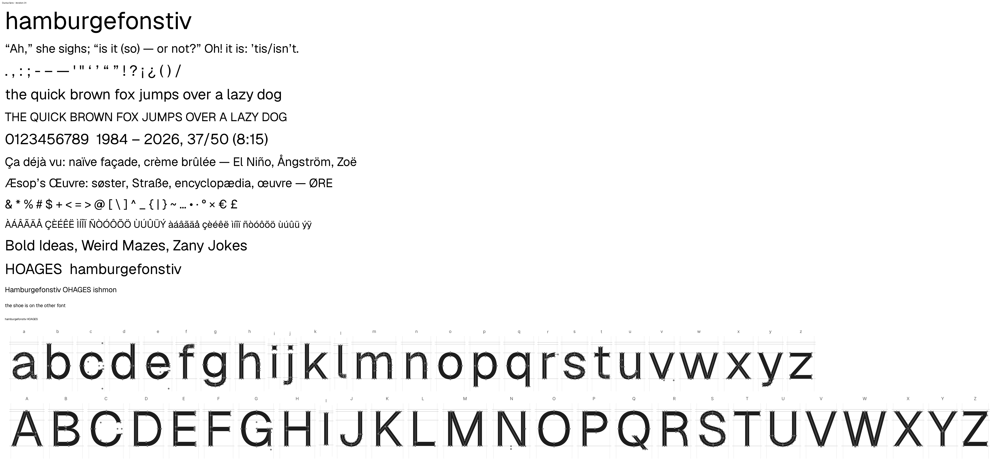

- **Bold f.** The hook started only 2 units below the stem's top, so a
  longer hook (Geist's runs about 25 further) left the stem's top corner
  poking out of the hook's inner edge, enclosing a pinhole. New
  `f_root_dy` (default 2) starts the hook further down inside the stem.
  Bold 0.940 → 0.979 (Hausdorff 29 → 16), Light 0.970 → 0.981.
- **O.** The Regular O was about 5 units narrower than Geist's on each
  side: 0.917 → 0.965. Q was refit after it (0.957 → 0.939 → 0.950).
  Ø 0.921 → 0.947.
- **@.** New `at_lean` (the inner stem's top offset, default 0; Geist's
  leans like an italic a). It needs the inner bowl moved as well, so it
  stays 0 for now. @ Bold 0.866 → 0.873, Light 0.822 → 0.839.
- **Sweep of the next-weakest glyphs per weight.**

  | Glyph | Weight | IoU |
  |---|---|---|
  | X | Light | 0.894 → 0.961 |
  | 0 | Light | 0.895 → 0.958 |
  | % | Light | 0.804 → 0.875 |
  | 9 | Light | 0.902 → 0.934 |
  | 2 | Light | 0.900 → 0.920 |
  | G | Light | 0.899 → 0.913 |
  | ( ) | Bold | 0.920 → 0.961 |
  | ^ | Bold | 0.921 → 0.928 (Hausdorff 30 → 11) |
  | × * $ 3 8 | various | small gains |

Mean IoU: Regular 0.9535 → 0.9551, Bold 0.9496 → 0.9506, Light
0.9295 → 0.9314. Kerning re-run at all three masters.

## 25 — round 7: every glyph below 0.93, and the serif benchmark

Every glyph still below IoU 0.93 was refit: 43 at Light, 21 at Regular
and 12 at Bold. Most of the Light ones had never had their own pass. The
Light H's bar, for example, was 85 thick against Geist's 66.

| Light glyph | IoU |
|---|---|
| N | 0.908 → 0.975 |
| H | 0.917 → 0.976 |
| P | 0.912 → 0.972 |
| Y | 0.923 → 0.976 |
| < > | 0.916 → 0.983 |
| ( ) | 0.903 → 0.972 |
| U | 0.909 → 0.953 |
| C | 0.910 → 0.947 |
| w | 0.909 → 0.948 |
| x | 0.903 → 0.936 |
| ^ | 0.905 → 0.937 |
| " | 0.912 → 0.933 |
| 6 | 0.903 → 0.926 |

Regular and Bold gained a little; the Bold 5 went from 0.917 to 0.929.

**The Geist Serif benchmark** (`benchmarks/geist_serif`, never released)
went through the same per-glyph pass, using `gfit.py --bench`. Its 16
glyphs were already fitted close to their construction's limit: mean IoU
stays at 0.9765. The worst deviations fell (s 12 → 7, u 16 → 8), and the
largest is now 16. In the overlays the remaining difference is a unit or
two on the hairlines.

The display serif (`examples/display_serif`) is designed by eye and is
never fitted, so it was not touched.

Mean IoU: Regular 0.9551 → 0.9557, Bold 0.9506 → 0.9508, Light
0.9314 → 0.9394. Kerning re-run at all three masters.

## 26 — round 8: the serif benchmark's full glyph set, and the sans at 0.93–0.95

**Geist Serif benchmark** (`benchmarks/geist_serif`, internal, never
released). The benchmark used to define only its 16 core glyphs
(`CORE = "onHeasgvhmburfti"`). It now defines the kit's whole set, which
was fitted glyph by glyph with `gfit.py --bench`. The display serif is
designed by eye and was not touched.

- **Starting point.** The 106 new glyphs started from the kit defaults:
  mean IoU 0.815, with % at 0.37, M 0.42 and A 0.51.
- **First pass.** Mean 0.917.
- **Width scan.** A coarse scan of each weak glyph's own width parameter
  helped where the fitter's small steps could not reach:
  - A: the kit's default width made it 922 wide against Geist's 759;
    0.51 → 0.74.
  - V: 0.71 → 0.89.
  - €: 0.76 → 0.86.
- **Style options matching Geist Serif:**
  - `G_jaw="serif"`, with the display serif's jaw values (the default
    jaw failed the stem lint);
  - `E_serifs="wedge"` (E: 0.794 → 0.879 before fitting);
  - `ced_style="tick"`.
- **Second pass** over the 51 glyphs still below 0.93.

Result: mean IoU over the 122 non-composite glyphs 0.815 → 0.933, with
82 of them at 0.93 or better. The core 16 hold at 0.9767. Still poor: &
(0.61) and @ (0.68), which differ in construction from Geist Serif's;
the cedilla (0.71); and the tilde.

**Sans.** Every glyph between 0.93 and 0.95 was refit: 37 at Light, 27
at Regular and 31 at Bold.

| Weight | Glyph | IoU |
|---|---|---|
| Light | v | 0.933 → 0.977 |
| Light | q | 0.946 → 0.979 |
| Light | Æ | 0.940 → 0.973 |
| Light | Œ | 0.935 → 0.970 |
| Light | j | 0.932 → 0.961 |
| Regular | M | 0.947 → 0.974 |
| Regular | D | 0.939 → 0.972 |
| Regular | % | 0.936 → 0.959 |
| Bold | V | 0.943 → 0.976 |
| Bold | / | 0.950 → 0.990 |
| Bold | \ | 0.947 → 0.986 |
| Bold | ! | 0.948 → 0.980 |
| Bold | J | 0.950 → 0.979 |

The Bold W was refit after the V changed their shared stroke widths
(0.938 → 0.912 → 0.943).

`tests/test_primitives.py`'s compile-time bound is now 1500 ms. On the
current, slower cloud container every kit font takes about 1.0–1.1 s,
whatever has changed.

Mean IoU (sans): Regular 0.9557 → 0.9570, Bold 0.9508 → 0.9529, Light
0.9394 → 0.9428. Kerning re-run at all three masters.
